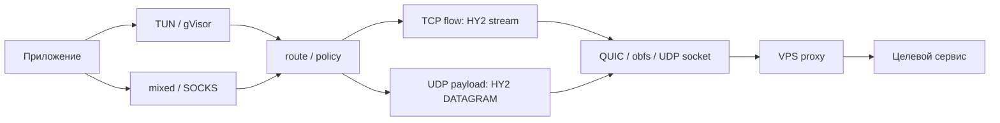

# R04 — путь трафика и бюджет полезной операции

Дата: 2026-10-25. Статус: **READY_FOR_REVIEW**, научное решение отсутствует.
Область: ручной анализ исходников и первоисточников; не измерение скорости.

## 1. Вопрос и отличие от существующей теории

Как разложить задержку, работу CPU и память одной защищаемой операции по
фактически вызываемым слоям, прежде чем менять транспортные настройки?
Основной разобранный carrier — HY2. Для TCP carrier отмечена граница сравнения;
его собственный handshake/mux в этом цикле полностью не разобран.

Baseline: THEORY §9, §12.6, §13.2–5/8/10, §14. Там уже есть BDP, MTU,
ограничения offload, send queue, keepalive и отсутствие публичного HY2 migration
seam. Они не выдаются здесь за новые открытия. Этот пакет добавляет:

| ID | Новый результат для проекта | Предел доказательства |
|---|---|---|
| R04-01 | Связанный путь split TCP и граф cold/warm стадий; worker IPC отделён от потока payload | Source-факт и модель, фактические времена неизвестны |
| R04-02 | Постоянный порог HY2 fragmentation, его влияние на внутренний QUIC и несовпадение size admission с packability | Вызываемые ветви и условный контрпример, без wire reproduction |
| R04-03 | Receive fanout после bounded queue, реальные свойства reclamation и совокупный ресурсный бюджет | Source-факт; перегрузка/RSS/race не воспроизводились |

«Новый» означает уточнение относительно указанных разделов проекта, не заявление
о научном приоритете или превосходстве над другими VPN.

## 2. Входы и воспроизводимость ручного анализа

Windows snapshot: **V2-157**; Android: **AND-12-S5 source unverified**.
В Android нет принятого whole adapted AAR/работающего APK/подтверждённого VPN.
Наличие Kotlin bridge не означает существование проверенного packet path на устройстве.
VPS не использовался; его текущий процесс, версия, qdisc, PMTU и ресурсы неизвестны.

Версии и полные commit указаны в [SOURCES](SOURCES.md). Сохранены 47 снимков
исходников/лицензий и шесть module Origin metadata. Для 18 ключевых файлов,
включая все шесть лицензий, bytes module cache совпали с raw по exact commit.
Это проверка происхождения прочитанных файлов, не целостности всей зависимости,
подлинности установленного EXE/AAR или поведения программы.

Доказательства: `.artifacts/research/theory-04/2026-10-25-budget-v1/`:
`source-manifest.json`, `cache-upstream-comparison.json`, `module-metadata/`,
`modules/`, `upstream/`, `project/`. Снимки получены последовательно, не атомарно.
Изменения текущего дерева после захвата проверяются отдельно в `source-drift.json`.
Финальная сверка: у всех 47 выбранных source/license inputs и их captures SHA256
не изменился. Это не распространяется на файлы вне списка и на дальнейшие изменения.

## 3. R04-01 — фактический путь и правильная граница времени

### 3.1. Windows: два входа, общий worker

В `windows/backend/render/render.go` TUN opt-in добавляет `stack=gvisor`;
mixed inbound остаётся для SOCKS/probe. Анализ относится к выбранному
защищаемому destination, не доказывает полный захват всех исключённых политикой сетей.
`NewIsolatedEngine` запускает отдельный worker; его протокол передаёт config и
команды start/switch/current/stop. В прочитанной цепи payload не проходит через
Wails/JSON IPC для каждого пакета (`engine.go`, `worker_child.go`, `worker_protocol.go`).



TCP из TUN разбирается gVisor: `TCPForwarder.Forward` создаёт `gLazyConn` и
передаёт соединение handler. Это split proxy path, а не помещение исходных
клиентских TCP/IP-пакетов целиком в reliable stream. [TCP forwarder][tun-tcp],
[lazy connection][tun-lazy]. Поэтому классический диагноз nested TCP retransmission
нельзя автоматически переносить на этот flow. Общая очередь и HOL внешнего TCP
carrier при потерях остаются возможны; это отдельное явление.

`route.ConnectionManager.NewConnection` сначала получает outbound connection,
затем сообщает local handshake success и выполняет `kickWriteHandshake`.
У HY2 `DialConn` после authenticated carrier только открывает QUIC stream;
target request пишется при первом Write. Ответ proxy читается при первом Read.
Это допускает local TCP acceptance до подтверждения подключения VPS к target.
Путь `Write(nil)` уже предусмотрен ядром, в том числе для server-first случая:
из lazy header нельзя выводить неизбежный deadlock или добавлять второй handshake
в приложении. [Connection manager][route-conn], [HY2 client][hy2-client].

На модельном VPS `service.handleStream` читает target request и передаёт его
handler; для server direct outbound target dial предшествует handshake response.
Это описание закреплённой server реализации, не установленного удалённого сервера.
[HY2 service][hy2-service].

### 3.2. Android: условный путь, не готовая поставка

Source candidate: VpnService → worker/`NativeRuntime` → `NativeWorkerSession`
→ whole libbox → `LibboxPlatform`/`AndroidTunFactory` → VPN fd → выбранный stack
→ тот же класс outbound. Фактический stack/MTU не задан выдуманными defaults:
`AndroidTunGraphSpec` требует явные адреса, MTU и SYSTEM/GVISOR/MIXED.
Transport fragment должен прийти от принятого trust/renderer; этого production
producer и approved adapted AAR пока нет. Windows module graph не является
dependency graph будущего Android binary.

Native/OS callbacks protect/bind/owner lookup — затраты setup/новых flows и
переходов. Из наличия JNI/Binder в control path нельзя приписывать каждому
payload packet Kotlin→Go→Kotlin обход. Android source/overlay acceptance и
реальная частота callback остаются обязательными будущими входами бюджета.

### 3.3. Полный latency budget одной операции

Сценарий: запуск VPN при необходимости, затем новый HTTPS TCP flow через HY2,
неизвестный ранее origin; успешный путь без отказов. App DNS выполнен в
защищённом resolver realm; если target уже получен как IP, второй server DNS
не добавляется. TLS/HTTP reuse и client/server-first задаются явно.

Все длительности `d_i` — **секунды**, все timestamps — один монотонный clock
внутри своей платформы. Remote timestamps без синхронизации не вычитаются.
Для графа зависимостей:

```text
t_i = d_i + max(t_j для j из parents(i))
T_first_useful = t_доставка_первого_полезного_ответа - t_действие_пользователя
T_complete = T_first_useful + остаточное время получения/обработки ответа
```

| Узел / бюджет | Что входит и от чего зависит | Cold / warm / предел |
|---|---|---|
| Подготовка до Manager | Trust/profile, защита, допуск операции, render; нужны реальные владельцы стадий | Не входит в время одного `Engine.Start`; измерений нет |
| Worker/core ready | Spawn, hello, parse/start ядра, установка виртуального интерфейса по выбранному режиму | Worker ready не означает HY2 auth или полезный ответ |
| System proxy и gate | В `Manager.Start`: prepare → engine.Start → SetProxy → lifecycle probe → publish | Это последовательная часть текущего source, не доказанный OS fail-closed |
| Protected probe | Admission + fanout шагов + ожидание + reduction; шаги могут разделять carrier | `T_probe ≈ d_admit + max_i elapsed(step_i) + d_reduce`, не сумма target RTT |
| App DNS | Ответ выбранного resolver с правильным scope; cache hit/miss, NAT64, имя gateway отдельно | DNS warm не означает origin TLS warm |
| Carrier offer/auth | Gateway resolve при необходимости, socket/protect/bind, QUIC/TLS и HY2 HTTP/3 auth | Текущий HY2 ожидает auth RoundTrip до выдачи stream; точное число RTT зависит от wire path |
| Local flow и header | Policy/owner, gVisor local handshake, open stream, HY2 request | Local acceptance не равна target connect; header может уйти до app payload |
| Target connect | VPS policy/resolver при domain target, TCP handshake к origin | Может перекрываться с подготовкой/передачей app payload; не считать DNS дважды |
| Origin TLS/HTTP | End-to-end TLS flights, запрос, server processing, обратная доставка | Отдельные connection reuse/resumption/HTTP версии; HTTP status не равно useful result |
| Steady transfer | Полезные bytes, CC/flow control, очередь, CPU, обработка приложения | Bulk goodput и interactive latency под той же нагрузкой измерять раздельно |
| Failure branch | Detect, допуск recovery, фактическое завершение старого owner, новый prepare/gate | Не входит в успешную сумму; для rejected/timeout отдельный outcome и deadline |

`ProtectedProbe.Run` запускает targets, DNS и OS-route control параллельно и ждёт
их фактического возврата. HY2 offer общий внутри одного Client. Закрытие HTTP idle
connections после probe не закрывает автоматически его QUIC carrier. При неизменном
outbound/session и живом carrier первая пользовательская операция может иметь уже
оплаченный auth. Это условие, не обещание вечного warm state: смена сети, Close,
expiry и новый worker его отменяют. HTTP pool до probe-origin также не становится
pool до произвольного пользовательского origin.

**Перспективное изменение R04-01:** сначала добавить у платформенных владельцев
раздельные bounded stage receipts к существующим lifecycle/flow boundaries и
сравнивать cold-core / warm-carrier / warm-origin. Затем сокращать только
доказанную повторную работу или optional teardown при неизменной authority.
Не добавлять второй keepalive, resolver, mux, carrier prewarm или handshake engine.

Предел выигрыша: если изменяемая стадия составляет долю `f` всего elapsed и
её можно ускорить в `s` раз, при неизменных остальных стадиях
`speedup <= 1 / (1-f+f/s)`. При полном устранении — `1/(1-f)`.
Доля `f` неизвестна; это условная модель, а не прогноз ускорения.
Контрпример: при target service delay оптимизация worker spawn не ускоряет
уже существующий flow; сохранение carrier при смене trust недопустимо.

## 4. R04-02 — три разных бюджета датаграммы

### 4.1. Постоянная fragmentation граница

В `newUDPPacketConn` поле `udpMTU` равно `1200-3 = 1197` bytes; других
присваиваний этому полю в просмотренном HY2 package нет. `WriteTo`/`WritePacket`
сначала фрагментируют по этому бюджету. После `DatagramTooLargeError` есть
повторное разбиение на меньший текущий максимум, но постоянное поле не обучается
росту PMTU. На каждом фрагменте destination записывается снова; удаление адреса
из последующих fragments закомментировано как несовместимое. [Packet path][hy2-packet].

Для адресной строки длиной `A` bytes и положительного `B-H`:

```text
H = 8 + varint_length(A) + A                  [bytes HY2 header]
C = B - H                                   [bytes payload / fragment]
F = ceil(U / C)                              [fragments / input UDP]
B = 1197                                    [initial HY2 message budget]
```

Пример по формуле, не эксперимент: `192.0.2.1:443` имеет `A=13`, `H=22`,
`C=1175`. Входной UDP payload `U=1200` требует двух HY2 fragments уже до
возможного уменьшения. Это существенно для внутреннего QUIC Initial: такой
datagram должен иметь UDP payload не меньше 1200 bytes. Не путать его с outer
QUIC Initial, inner IP MTU или Salamander salt. [RFC9000 §14.1][rfc9000].

При условии разных независимо теряемых outer packets с вероятностью потери `p`
вероятность сборки составляет `(1-p)^F`, не `1-p`. Это модель одного сообщения:
burst/correlated loss, queue drops и packetization нарушают независимость.
Число syscalls не обязательно равно F: kernel/offload могут batch работу.
HY2 specification требует всю группу fragments для восстановления сообщения;
QUIC DATAGRAM сам не фрагментируется и не retransmit payload. [HY2 protocol][hy2-protocol],
[RFC9221 §5][rfc9221].

### 4.2. Почему нельзя просто поднять 1197 или довериться успешному SendDatagram

Нужно различать outer UDP/QUIC packet ceiling, допустимый QUIC DATAGRAM payload
и HY2 payload после H. В pinned quic-go `SendDatagram` проверяет peer limit и
`currentMTUEstimate`, затем копирует data в queue. Packer отдельно вычитает
short header и encryption tag; кадр, который не помещается, может быть снят
из очереди без отправки. [SendDatagram][quic-conn], [packet packer][quic-packer].

Дополнительная source inconsistency: начальная estimate получается через
`estimateMaxPayloadSize`, а ACK path записывает в ту же переменную полное
`mtuDiscoverer.CurrentSize()`. Последнее — размер probe packet, не HY2/QUIC
application payload. Следовательно, API admission и packability имеют разные
границы. Условный контрпример: после такого обновления peer limit позволяет L,
`L <= storedEstimate`, но `L + frame_header > M - short_header - tag`.
SendDatagram может принять такой L, а packer его снять. Это source-level
контрпример контракта, не воспроизведённая потеря штатного VPN.

Важное ограничение: default QUIC initial packet size здесь **1280**, а HY2 cap
1197 консервативен. Пример с произвольным L нельзя выдавать за наблюдённую ошибку
обычного HY2 flow. Эта inconsistency прежде всего блокирует наивное расширение
fragmentation ceiling через «попробовать целиком и поверить nil error».
Даже корректный enqueue никогда не является application-delivery receipt.

**Перспективное изменение R04-02:** узкое upstream/adapter изменение,
согласующее datagram payload budget с packer, peer limit, obfs overhead и
connection/path generation; затем адаптация существующего HY2 fragmenter.
Текущий public ClientOptions этого capability не предоставляет. Сначала review
и будущая регрессия API/packer, потом расширение размеров; не новый fragmenter.
Цена: upstream adaptation, stale-budget/fallback complexity, allocations и wire
compatibility review. При малом PMTU или коротких media packets выигрыш может
отсутствовать. Большая датаграмма может чаще теряться на конкретном пути.

## 5. R04-03 — bounded queue не ограничивает receive work и resident memory

HY2 `Client.loopMessages` после каждого `ReceiveDatagram` запускает отдельную
goroutine для `handleMessage`. В этой ветви нет admission по количеству активных
обработчиков или их bytes. Это происходит **после** QUIC receive queue и **до**
публикации в per-session `data` channel. Поэтому caps 128 receive frames и
64 готовых сообщений на UDP session не ограничивают число уже извлечённых
datagrams/handlers. [Receive dispatcher][hy2-dispatch], [packet queues][hy2-packet].

При длительной нагрузке arrival rate `lambda > mu` модель backlog растёт примерно
как `(lambda-mu)*time`; это объяснение риска, не измеренная скорость роста.
Реальная сеть/CPU/ОС конечны, но source не задаёт требуемого явного cap этой стадии.
Не переносить вывод автоматически на сервер: его dispatcher проверяется отдельно.

Reassembly дополняет exposure. `newUDPDefragger` использует LRU с age10s и
refresh-on-get, без WithSize. Expiry проверяется при работе с cache; timer janitor
не создан. При отсутствии новых обращений спустя 10s payload не обязан быть
освобождён. При completion fragments освобождаются, но packetItem остаётся
в cache с пустыми messages; на неполной сборке сохраняются принятые fragments.
Повторное обращение продлевает возраст, поэтому это не hard deadline от первого
fragment. [Reassembly][hy2-packet], [exact LRU semantics][lru].
Освобождение ownership буфера также не означает немедленного снижения RSS:
pool/allocator/GC могут удерживать capacity. Отдельно считать живые payload,
retained capacity и весь процесс; не устанавливать RSS-SLA по одному cache age.

Не называть map бесконечной внутри одной session: её ключ uint16 даёт не более
65536 значений. Однако это не общий лимит всех sessions и не bytes budget.
Sender ограничивает исходящий UDP payload `protocol.MaxUDPSize=4096`; это
ограничение данной реализации, не предел UDP/Android TUN. Из него не следует
корректность MTU=4096 или аналогичная проверка всех входящих reassembled bytes.

**Перспективное изменение R04-03:** ограничить receive admission до создания
goroutine, отдельно active handlers и retained bytes; определить per-session/global
reassembly count/bytes и release ownership. Сравнить serial dispatcher с bounded
sharded workers, сохранив полезный порядок и справедливость между sessions.
При overload разрешённый UDP drop должен иметь причину/счётчик и не превращаться
в бесконечную очередь. Никакого blocking wait на UI/native control thread.

Reuse: существующий Go channel или nonblocking `semaphore.Weighted.TryAcquire`
из уже имеющегося x/sync0.20.0; существующий LRU WithSize/WithEvict как строительные
блоки. Это **не drop-in fix**: handler fanout делает feed/eviction конкурентными;
в текущем eviction callback release не синхронизирован через item.access.
Новый janitor/size cap/Delete требует явной lifetime/lock-order проверки, нельзя
просто вставить Delete под item mutex или освобождать буфер по timeout вызывающего.
[Weighted semaphore][semaphore], [LRU][lru].

Цена/контрпример: serial handler может задержать остальные flows на одном медленном
сообщении; малый cap роняет корректные bursts, большой сохраняет RSS/GC pressure.
Один cap goroutines не ограничивает fragment bytes. Периодический janitor сам
создаёт wakeups; использовать bounded sweep/существующие события, а не постоянный
Android polling. Числа W, bytes и lifetime пока unknown, их нельзя выдать за оптимум.

## 6. Сводный ресурсный бюджет

Разложение для одного клиента; реальный RSS не равен сумме payload lengths:

```text
M_process = M_base + M_flows + M_streams + M_ready_queues
          + M_active_handlers + M_reassembly + M_pools + M_other_runtime
M_reassembly = sum_sessions sum_items (entry + fragment slots + retained allocations)
CPU_s_per_s = cost_byte * bytes_per_s + cost_packet * packets_per_s
            + cost_new_flow * new_flows_per_s + cost_callback * callbacks_per_s
E_session [J] = E_CPU + E_radio + E_awake + E_other
G_useful [bytes/s] <= min(access, outer path, VPS CPU budget, egress, target)
T_body [s] >= remaining_useful_bytes / G_useful
```

Каждый cost имеет соответствующие единицы CPU-s/byte, CPU-s/packet и т.д.
Все коэффициенты и M_base сейчас **unknown**. Kernel socket buffers, Windows GUI/
helpers, Android Kotlin/JNI/mmap и VPS services учитывать отдельно; GOMEMLIMIT
не становится общим пределом RSS. CPU/bytes и CPU/packet сравнивать одновременно.
Слагаемые определяются без двойного учёта общих buffers; allocated capacity
отличается от текущего payload length. Законы средних очередей не являются hard cap.

| Слой | Что уже ограничено | Что остаётся измерить / ограничить |
|---|---|---|
| Worker control | Config 2MiB, reply 4096 bytes; source timeouts | Реальный spawn/parse peak, process death, GUI+worker+helper RSS |
| HY2 carrier/streams | Существующие windows/CC и lifecycle | Фактически заполненные буферы; stream count, retransmits, slow readers |
| QUIC DATAGRAM | Send32 / receive128 frames | Bytes/frame, blocked send owners, packetizer drops; это не end-to-end cap |
| Receive handler | В рассмотренной ветви отдельного admission нет | Active count/bytes, scheduling/GC, session fairness |
| UDP session | Ready channel64 | Retained allocations, fragment memory, число sessions и idle lifetime |
| Android OS callbacks | Bridge admission32, fence/retirement | Frequency/duration новых flows, native heap; не умножать callback cost на каждый packet |
| Android radio | Периоды ядра не являются жёсткими SLO | Wakeups и metered bytes в idle/call/bulk; меньше packets не гарантирует меньше J |
| VPS | Текущих наблюдений нет | Available CPU/quota/steal, UDP drops, RAM, storage/log growth, server pin |

Wire budget: полезные U bytes превращаются в U + F*H + outer framing/padding/obfs,
плюс ACK/probes/retransmitted reliable data и failed attempts. Считать bytes за
весь successful outcome вместе с отказавшими попытками, а не только итоговый flow.

## 7. Очерёдность предложений разработчикам

Это предложения к существующим требованиям, не новый продуктовый реестр и не
закрытие их статусов. Платформенные планы изменяют их владельцы.

| Порядок | Срез / адресат | Existing requirements | Условие перехода |
|---|---|---|---|
| 0 | Сохранить safety/lifecycle gates и явно выбрать воспроизводимый artifact/path | OFF-01…09, TH-01…04, AND-01/02 | План/код не подменяет OS/native acceptance |
| 1 | R04-01: минимальные stage receipts и cold/warm baseline; Windows/Android owners | TH-06, FR-012, COM-12, AND-11/15 | Понятны clock/scope и критическая стадия; метрики bounded/privacy-safe |
| 2 | R04-03: bounded receive work и memory ownership; core/platform owners | RQ-03, TH-06, COM-12, AND-01/11/15 | Сначала ownership/ordering/drop contract, затем разрешённая concurrency/resource regression |
| 3 | R04-02: size API/packer seam, затем HY2 fragmentation adaptation | RQ-02/03, TH-05/06, AND-01/11 | Не доверять enqueue как wire receipt; small-PMTU/overhead/fallback cases приняты |
| 4 | Только при соответствующем bottleneck — mux/CC/offload/stack comparison | TH-05/06, RQ-01/02 | Native compatibility и controlled measurements, один фактор за раз |

Никаких новых ролей CLI, dependency upgrade, реализации или запуска этими
предложениями не выполнено. Android переносит только применимые выводы после
проверки своего whole artifact. Единственный VPS не становится отказоустойчивым
от оптимизации receive loop; инфраструктурная независимость вне этого среза.

## 8. Будущие конечные проверки — не запускались

| Набор | Положительные случаи | Отрицательные / критерий провала |
|---|---|---|
| L1: latency DAG | Cold core; warm carrier/cold origin; warm origin; TUN и SOCKS отдельно | Carrier auth/refusal/expiry, server-first, cancel: local success не завершает useful outcome |
| D1: fragment boundary | U=C-1/C/C+1, 1200, 4096; IPv4/IPv6/domain address lengths | U4097 rejected по контракту; B<=H/invalid destination должны быть ограничены; без повторной отправки уже принятого logical UDP |
| D2: actual packet budget | Peer small limit, default1280, PMTU increase/decrease, salt8, ACK present/absent | Accepted API payload не должен молча пропадать из-за несогласованных величин; менять одно условие за раз |
| D3: loss/reassembly | All fragments, reorder, duplicates; независимо cold/warm | Missing fragment, stale generation/ID reuse, partial-send error; не склеивать разные сообщения |
| R1: resources | Ниже cap; допустимый burst; разные sessions; один bulk плюс interactive flow | Выше W/bytes/session caps: bounded backlog и явный drop, без starvation/leak/double release |
| R2: retirement | Idle expiry, completed item, session close, cancel в разных стадиях | Feed concurrent with eviction/sweep/Close, clock change: timeout не разрешает преждевременное release |
| A1: mobile/host | Android idle/screen-off/handover/call/bulk; маленький VPS под заявленным ресурсным профилем | Battery/wakeups/RSS/GC/latency соседнего потока ухудшаются за заранее заданный допуск → reject/rollback |

Baseline values, tolerances, duration и sample adequacy задаются до сравнений.
Метрики: useful completion by deadline, TTFB/end-to-end tails, useful/wire bytes,
packetizer/drop/reassembly counters, CPU-s, allocated/retained bytes, goroutines,
peak combined RSS, Android energy/wakeups. Единый byte budget не приравнивается
к независимой статистике: постановка оценки принадлежит R03, safety — R05.

## 9. Предлагаемая вставка в общую теорию

Предлагаемое уточнение после §14.4 со ссылками на источники этого пакета.

> Для pinned HY2 отдельно учитывать стоимость cold carrier, local flow acceptance,
> target connection и useful response: TUN/gVisor TCP использует split proxy path,
> а возврат HY2 DialConn ещё не означает подключение VPS к target. Общий carrier
> может быть уже подготовлен protected gate; нельзя повторно прибавлять его auth
> ко всем параллельным probe/пользовательским flows.
>
> HY2 использует постоянный message budget1197 до вычитания собственного header.
> Поэтому внутренний UDP payload1200 может требовать несколько fragments даже
> на пути с большей PMTU. Расширение cap требует согласовать peer datagram limit,
> actual packetizer overhead, obfs и path generation. В текущем quic-go size
> admission и packer не дают универсального доказательства отправки по nil error.
>
> Receive queue128 и ready channel64 не ограничивают active receive handlers:
> HY2-клиент запускает отдельную goroutine на datagram. Reassembly age10s является
> ленивым sliding expiry, а не гарантированным временем освобождения памяти.
> Нужны отдельные active-work/bytes/session/reassembly caps с безопасным ownership.
> Все эти выводы подтверждены чтением source; эффект на производительность и
> поведение конкретной поставки требуют разрешённой native/resource приёмки.

[tun-tcp]: https://github.com/SagerNet/sing-tun/blob/7c73233bd0fb0dae02e76505af888ef729319be9/stack_gvisor_tcp.go
[tun-lazy]: https://github.com/SagerNet/sing-tun/blob/7c73233bd0fb0dae02e76505af888ef729319be9/stack_gvisor_lazy.go
[route-conn]: https://github.com/SagerNet/sing-box/blob/b5ebaa1fc0f2b94256180b95468e73ef53caa27d/route/conn.go
[hy2-client]: https://github.com/SagerNet/sing-quic/blob/d83826c306d7c008cafb3fd6d8ee07cbcfd656ed/hysteria2/client.go
[hy2-service]: https://github.com/SagerNet/sing-quic/blob/d83826c306d7c008cafb3fd6d8ee07cbcfd656ed/hysteria2/service.go
[hy2-packet]: https://github.com/SagerNet/sing-quic/blob/d83826c306d7c008cafb3fd6d8ee07cbcfd656ed/hysteria2/packet.go
[hy2-dispatch]: https://github.com/SagerNet/sing-quic/blob/d83826c306d7c008cafb3fd6d8ee07cbcfd656ed/hysteria2/client_packet.go
[quic-conn]: https://github.com/SagerNet/quic-go/blob/ccd46abedd39c6f8384b1df8daf42008724958f5/connection.go
[quic-packer]: https://github.com/SagerNet/quic-go/blob/ccd46abedd39c6f8384b1df8daf42008724958f5/packet_packer.go
[lru]: https://github.com/SagerNet/sing/blob/7c349dacf402256d3a7029746073b05d2ead584a/common/cache/lrucache.go
[semaphore]: https://github.com/golang/sync/blob/ec11c4a93de22cde2abe2bf74d70791033c2464c/semaphore/semaphore.go
[rfc9000]: https://www.rfc-editor.org/rfc/rfc9000.html#section-14.1
[rfc9221]: https://www.rfc-editor.org/rfc/rfc9221.html#section-5
[hy2-protocol]: https://v2.hysteria.network/docs/developers/Protocol/


<a id="r04-002"></a>

## 10. R04-002 — обслуживание общего HY2 carrier при конкуренции TCP/UDP

2026-10-25. **READY_FOR_REVIEW**, автор «Теория 4».
Первый пакет R04-001 выше сохранён; его научный ACCEPTED ещё не получен.
Этот цикл выполняет DEPTH-CYCLE-002. Ниже — новый самостоятельный срез.

### 10.1. Новизна, входы и уровень доказательства

R04-001 установил per-datagram fanout, fixed1197 и lazy reassembly age.
THEORY §13–17 уже различает QUIC streams, congestion, queues и missing outcomes.
Новый вопрос: **какую долю обслуживания получают реальные consumers общего
carrier и какие ограничения переживают передачу владения буфером?**

| Вывод | Новое относительно R04-001 | Тип основания |
|---|---|---|
| R04-04 | Порядок DATAGRAM → residual STREAM и порог128 позволяют условное исключение TCP из обычных packet opportunities | Exact caller/branch + ручной допустимый trace; runtime не воспроизводился |
| R04-05 | Count/byte credits должны передаваться между обработчиком, reassembly, ready и retiring; завершение handler не замыкает memory bound | State conservation model, server/client source asymmetry и allocation-before-drop |
| R04-06 | Текущий expiry/eviction callback не участвует в item.access; concurrent client feed допускает trace освобождения ещё используемого message | Анализ существующих двух call paths; не подтверждённый race/crash/эксплойт |

Pin не менялся: quic-go `ccd46ab…`, sing-quic `d83826c…`, sing `7c349da…`,
x/sync `ec11c4a…`; полные версии/лицензии и symbols — [SOURCES §7](SOURCES.md#r04-002-sources).
Baseline проекта уже другой: захвачены **Windows V2-162 / Android AND-11-S2**,
вместо V2-157/AND-12-S5 первого пакета. Новый Android reserved-retirement RPC
прочитан отдельно. На этом датированном срезе approved AAR/native/device evidence отсутствовало;
позднейшая Android-приёмка учитывается отдельно в текущем плане.

Capture root: `.artifacts/research/theory-04/2026-10-25-hy2-scheduler-v2/`.
В manifest 31 module source/license, 11 project inputs и три сохранённых документа
первого пакета: всего45. Четыре Origin records получены заново;17 выбранных
raw/cache comparisons совпали, включая четыре LICENSE. Полная область сверки
и финальные изменения входов — `source-drift.json`; предыдущий пакет не переснят.

### 10.2. Полный граф обслуживания: разные units и receipts

Один carrier = один HY2 Client/QUIC connection. Направления передачи имеют
отдельное CC/ACK состояние; конкуренция внутри каждого направления общая.

```text
TCP flow
 app/TUN proxy -> HY2 clientConn.Write -> SendStream.Write
 -> nextFrame / dataForWriting / retransmissionQueue
 -> framer active stream IDs -> stream + connection send credit
                                         \
UDP session                               shared send decision
 WriteTo/WritePacket -> HY2 fragmenter      / CC, pacing, packet history
 -> pack -> SendDatagram copy -> queue32 --/
 -> AppendPacket / composeNextPacket:
    ACK -> at most one DATAGRAM -> control retransmissions
        -> framer control -> eligible STREAM visits
 -> packet buffer -> sendQueue8 entries -> socket Write -> wire
 -> peer ACK/loss -> reliable stream callbacks / buffer ownership

receive wire -> QUIC decrypt/parse -> DATAGRAM copy BEFORE queue cap check
 -> receive queue128 -> ReceiveDatagram
    client: spawn handler per datagram
    server: handle serially per serverSession, new handler per new UDP session
 -> decode -> session lookup -> inputPacket
 -> direct message OR concurrent reassembly feed/cache
 -> per-session ready64 -> ReadFrom/WaitReadPacket -> consumer
 -> actual release / reusable pool (не обещанный немедленный RSS drop)
```

TCP payload в этом графе — proxy bytes, а не исходные TCP/IP packets из TUN.
Внутренний app QUIC остаётся UDP payload и добавляет свои ACK/recovery/CC;
такой workload отличается от proxy TCP. Полный IP tunnel нового типа не вводится.

Проверяемая цепь отправки: `Conn.triggerSending` → `SendMode` → sendPackets
→ appendOneShortHeaderPacket → packetPacker.AppendPacket → composeNextPacket
→ framer.Append → SendStream.popStreamFrame. GSO меняет batching socket writes;
правило композиции каждого QUIC packet остаётся. [Connection][d2-conn],
[packer][d2-packer], [framer][d2-framer].

`SendMode` сначала проверяет amplification/history/PTO/CC/pacing. Datagram и
stream не получают по отдельному congestion window. Stream дополнительно
использует `min(stream credit, connection credit)`. DATAGRAM не потребляет
stream/connection flow-control credit; receiver может его сбросить при нехватке
ресурсов. Это не обход congestion control. [RFC9221 §5.3–5.4][d2-rfc9221],
[flow controller][d2-fc].

`SendStream.Write` может завершиться после копирования небольшого остатка в
nextFrame; дальнейшие `OnAcked`/`OnLost` распоряжаются frame. OnLost может
поставить тот же reliable data в очередь повторной передачи. TCP-stream
retransmissions живут также в SendStream, не только в общей control retransmission
queue. [SendStream][d2-stream]. Поэтому chain receipts различается:

| Событие | Что оно устанавливает | Чего ещё нет |
|---|---|---|
| Local TCP/SOCKS success | Создан локальный flow/объект outbound | Target/useful completion |
| Write accepted / queue Add returned | Bytes скопированы/приняты соответствующим слоем | Wire send, peer processing, application outcome |
| DATAGRAM queue Pop | Frame снят с очереди; разбудился Add waiter | Он мог быть снят packer без отправки |
| Socket write returned | Локальная работа данного socket call завершилась | Доставка peer/useful reply |
| QUIC ACK | Transport receipt; reliable frame может освободиться | Application consumption; это отдельно указано RFC9221 для DATAGRAM |
| Handler returned | Локальный обработчик перестал выполняться | Буфер мог перейти в cache/ready/consumer |
| Cancellation/Close requested | Началась retirement операция | Завершение всех borrowers/процесса и возврат memory credits |

### 10.3. R04-04 — условное исключение STREAM по размеру

В ordinary composeNextPacket первым после ACK рассматривается один DATAGRAM.
Остаток поступает framer. Его цикл STREAM не начинается при остатке <128 bytes.
Внутри доступного остатка IDs обходятся round-robin; это локальный порядок
визитов, без минимальной доли для stream относительно DATAGRAM. Число128 —
эвристика реализации, не минимальная длина STREAM по RFC. [Packer][d2-packer],
[framer.Append/getNextStreamFrame][d2-framer].

Обозначим в bytes: M — QUIC packet ceiling без outer IP/UDP/obfs; Hq — short
header + tag; A — ACK bytes; D — полный DATAGRAM frame; C — прочие frames,
записанные до STREAM. Остаток:

```text
R = M - Hq - A - D - C
necessary source condition for a STREAM visit: R >= 128
```

Это условие визита, а не гарантия payload: нужен flow credit, активный stream и
реальная работа. Другие control frames могут дополнительно съесть остаток.

**Ручной trace с достижимым caller, не симуляция:**

1. Уже authenticated HY2 carrier; один eligible TCP stream ожидает отправки.
   Stream и connection credits положительны; нет обязательного закрытия.
2. UDP payload1175 к адресной строке `192.0.2.1:443` длиной13 формирует HY2
   message1197 без fragmentation. QUIC DATAGRAM header для этой длины —3;
   D=1200. Это допустимый размер меньше исходящего MaxUDPSize4096.
   Документационный адрес иллюстрирует длину; для реального flow нужен разрешённый
   policy destination той же длины. Никакой endpoint в этом trace не вызывался.
3. M=1280 соответствует initial packet size данного pin. Выбираем допустимое
   состояние, где DATAGRAM помещается, ACK отсутствует/мал и новый крупный
   DATAGRAM доступен к каждой ordinary packet opportunity. Queue32 конечна,
   producer может пополнять её после Pop; бесконечный queue size не требуется.
4. При A=C=0 остаток R=80-Hq <128. framer не делает ни одного STREAM visit.
   Positive flow credit и round-robin список эту ветвь не изменяют.
5. Для сколь угодно долгого такого интервала ordinary STREAM service равен0.
   Для длительного контрпримера предполагается, что M не растёт: peer/path
   ceiling либо неуспешные более крупные probes. Наблюдаемая частота неизвестна.

**Сильнейшее возражение:** реальный UDP workload не обязан выдавать только полные
frames. Например, fragmentation UDP1200 даёт короткий хвостовой fragment; в его
packet TCP может получить место. PMTU growth, паузы UDP, другой ACK/control mix,
PTO/handshake paths и app deadlines меняют trace. Следовательно, тезис «любой
UDP навсегда блокирует TCP» отвергнут. Подтверждается отсутствие гарантированной
ordinary STREAM share при описанных совместимых условиях, не общий VPN freeze.

Практическая связь с проектом: protected HTTPS probe и DoT resolver могут
использовать TCP streams того же выбранного HY2 outbound. Их timeout в такой
нагрузке не идентифицирует блокировку оператора. Current Windows renderer
задаёт tunnel DNS через proxy, а ProtectedProbe использует mixed/SOCKS.
Это механизм для R03 observer-health/cost model; он не разрешает ослабить gate.

**Ещё одна граница fairness:** Add ставит уже допущенные frames FIFO, но waiting
Add producers ждут общего sent channel и снова соревнуются за lock/slot.
Новый producer может занять освобождённое место раньше старого waiter.
Arrival-order fairness или срок ожидания writer этим API не обещаны.
FIFO delivery bounds для32 принятых frames не распространяются на внешних
writers и не превращают Pop в wire receipt. [Datagram queue][d2-queue].

### 10.4. R04-05 — ограничения должны пережить handoff ресурса

Client receive fanout из R04-001 теперь сопоставлен с server path:
`serverSession.loopMessages` вызывает handleMessage синхронно; отдельная
goroutine появляется при новом UDP session handler. Клиент запускает handler
на каждый datagram. Поэтому upload/download и client/server resource profiles
нельзя объявлять симметричными. Source server допускает MaxIncomingStreams=2^60;
это protocol ceiling, а не полезный эксплуатационный cap flows/sessions.
[Client dispatcher][d2-client], [server dispatcher][d2-server].

Внутренний QUIC receive queue делает allocation/copy **перед** проверкой len128.
Если замедлить HY2 reader, queue перестанет расти после cap, но входящие frames
продолжат оплачивать QUIC processing и эту копию до drop. Семафор выше в HY2
не ограничивает уже выполненную работу ниже него. [HandleDatagramFrame][d2-queue].

У client dispatcher ошибка handleMessage закрывает общий carrier. Поэтому
будущий resource reject нельзя без анализа представить обычным parse error:
optional overload drop иначе оборвёт и независимые TCP streams. Нужен явный
nonfatal drop outcome с actual release; fatal protocol/connection errors остаются
отдельными. Это уточнение предлагаемого admission contract, не изменение кода.

Контрпример распространённому memory budget: handler получает byte permit,
кладёт fragment в reassembly и возвращает permit по defer. Следующий handler
получает тот же permit, а первый fragment остаётся retained. Повторяя для новых
packet IDs/sessions, сохраняем W active handlers и нарушаем ожидаемый retained
byte cap. Ограничение W*P относится только к выбранной фазе обработки.

Нужен accounting по состоянию владения:

| Переход | Кому принадлежат live bytes / credit | Условие возврата |
|---|---|---|
| Receive → dispatcher | Raw allocation/handler owner; count и bytes отдельно | Не только ctx.Done, а actual handoff или release |
| Dispatcher → fragment cache | Частичная сборка и её entry/slots | Credit переносится entry; handler возвращает только собственный work slot |
| Fragments → assembled buffer | Старые fragments плюс новая allocation на фазе copy | Сначала зарезервировать overlap/выход, потом actual release исходных fragments |
| Assembled → ready64 → consumer | Session/consumer lease | Channel send/read — смена owner, не исчезновение allocation |
| Live → retiring/evicted | Отделённый retired owner и ещё активные borrowers | Возврат credit после последнего borrower и разрешённого release |
| Release → pool | Pool/allocator retained capacity | Credit для live payload можно вернуть; RSS/pool budget учитывается отдельно |

Если U bytes собираются копированием из fragments в новый U-byte buffer, только
payload overlap может достигать2U до освобождения исходных частей. Capacity,
metadata и адресные строки дают дополнительные затраты. Это lifetime модель,
не измеренный allocation peak данной платформы.

Drop/eviction не бесплатны. Отброшенный fragment может обесценить ранее
принятые fragments того же logical UDP. Слоты на целую группу улучшили бы
accounting, но текущий public SendDatagram имеет per-frame API, без atomic batch
reservation/commit всех F fragments. Внешний semaphore сам не резервирует
внутреннюю queue32; нужны согласованные владельцы всех producers и rollback
неотправленной работы. Устаревший datagram не получает бесконечные retries.

### 10.5. R04-06 — текущий eviction не замыкает borrower lifetime

Текущий client handler fanout допускает параллельные feed одной session.
`LoadOrStore` освобождает cache mutex до захвата item.access. Операции feed
держат item.access, но onEvict вызывает releaseMessages(value.messages)
без этого mutex. maybeDeleteOldest вызывает callback при insertion/expiry
под cache mutex. [HY2 feed/onEvict][d2-packet], [LRU][d2-lru].

Допустимый по прочитанным guards trace:

| Шаг | Borrower A | Handler B / cache |
|---|---|---|
| 1 | Получил item p, обновив expiry; держит p.access, завершает сборку из двух fragments | Других ссылок, запрещающих eviction p, cache не учитывает |
| 2 | После записи второго fragment приостановлен до/во время чтения messages, сохраняя lock и ссылку | Прошло >10s; для этого trace достаточно паузы A, не всего процесса |
| 3 | Ссылка/lock A ещё действуют | Приходит fragmentTotal2 другого packet ID q той же session; insertion вызывает expiry p |
| 4 | Продолжает использовать messages p | onEvict без p.access освобождает их; udpMessage.release обнуляет объект и возвращает его в pool |
| 5 | Может увидеть обнулённый или повторно используемый message/data | Cache больше не владеет p, но borrower A ещё не завершён |

`buf.Buffer.Release` для unmanaged buffer может быть no-op; это не опровергает
trace: udpMessage.release отдельно обнуляет сам message. Не заявляется, что
каждый Release освобождает backing bytes в ОС. Следствие — незамкнутый контракт
логического владения; конкретное исключение/повреждение/частоту не измеряли.

**Возражения и границы:** feed обычно короток, и долгая индивидуальная пауза может
быть редкой; global stop-the-world сам по себе не даёт B выполняться параллельно.
На серверном serial dispatcher этот конкретный client trace не переносится
автоматически. Тем не менее source не содержит maximum scheduling gap/borrower
fence, который запрещал бы описанное чередование на клиенте. Это условный source
counterexample, не подтверждённая security vulnerability и не race-test PASS.

Новый janitor/WithSize может сделать тот же конфликт менее зависимым от age.
Добавление p.access в callback тоже требует review: callback вызывается под
cache mutex, а будущий Delete под item mutex создаёт обратный lock order.
Предпочтения для рассмотрения: единый сериализованный owner feed/eviction либо
two-phase detach с учётом borrowers и bounded retired bytes. Generic cache cap
может ограничить число **видимых entries**, оставляя память retired entries
до actual completion. Без admission новых allocations такой cap не hard memory cap.

### 10.6. Ручные bounds: что действительно следует из условий

Локальные source ceilings не складываются в один магический cap:

| Область | Доступный bound | Почему это ещё не общий bound |
|---|---|---|
| DATAGRAM send queue | <=32 admitted frames; при payload cap D не более32D payload bytes | Blocked Add callers уже держат свои копии, их count вне32; pending time неизвестен |
| QUIC async send queue | <=8 queued entries; backing capacity каждого <=20KiB на прочитанном builder path | Entry может включать GSO packets; active writer/builder/probes и pools считаются отдельно |
| Enqueued send backing | <=8*20KiB=160KiB как консервативная сумма capacities именно этой очереди | Не предел всего carrier/process; actual non-GSO buffer1452 меньше |
| Receive queue | <=128 visible frames; <=128P payload при установленном P | Copy-before-drop, extracted handlers и retained backing/pool находятся вне видимой очереди |
| Ready per UDP session | <=64 messages; <=64U при установленном receive/reassembly U | Sender cap4096 не устанавливает такой U для каждого input receiver |
| Reassembly | uint16 key: <=65536 entries/session, fragment count <=255 | Практические K/bytes/lifetime/число sessions не установлены этим числом |
| Framer | <=N active IDs посещается за Append; QueueControlFrame guard16384, path responses256 | Append имеет прямые enqueue control frames вне guard; глобальный control cap16384 не доказан. N/стоимость визита не дают wall-time bound; residual<128 делает STREAM visits0 |

Формула для будущего **live payload envelope**, если S sessions, W handlers,
K partial items/session, J fragments/item и P/U byte caps действительно
enforced, а A — число одновременных assembled allocations:

```text
M_live_payload <= 128P + WP + S*(64U + K*J*P) + A*U + B_retiring + B_tx_live
additional terms: entry/slot/string metadata, allocator/pools, OS/JNI/kernel
```

Это достаточно консервативная сумма областей владения; shared backing нужно
учесть без ошибочного повторного дебета. Capacity может превышать len(payload).
В текущем коде часть названных adapter caps не задана; формула не является
доказанным hard bound нынешнего приложения или RSS.

Для work считать отдельно packets/s и bytes/s:
`CPU-s/s = c_packet*lambda_packet + c_byte*lambda_byte + c_flow*lambda_flow`
с дополнительными затратами lookup/locking/scheduler. Byte cap позволяет много
мелких packets; count cap позволяет крупные allocations. Коэффициенты неизвестны.

**Возможная проверяемая scheduling гарантия вместо мнимого миллисекундного SLO:**
если adapter обеспечивает >=1 eligible STREAM visit на каждые K ordinary packet
opportunities и N ограниченных активных streams обходятся RR, то при сохранении
eligibility ожидание визита <=N*K opportunities. Для byte-rate нужны minimum
payload credit и service rate дополнительно. При неизвестном интервале между
opportunities перевод этой границы в секунды невозможен.

**Условная модель времени с доказательством предпосылок:** arrival envelope
`alpha(t)=sigma+rho*t` в bytes, service lower curve
`beta(t)=R*[t-T]+`, R>=rho>0 bytes/s, T seconds, FIFO для delay конкретного byte.
Тогда backlog<=sigma+rho*T; delay<=T+sigma/R. Для backlog максимум alpha-beta
находится при t=T. Для delay требуется d>=T+sigma/R, чтобы
`sigma+rho*s <= R*(s+d-T)` для всех s>=0. Packetization/non-preemption errors
должны быть уже включены в T либо добавлены явно. [Network calculus][d2-netcal].

Эта модель **не установлена** для открытого Интернета: CC/speedtest дают не
постоянный lower R, а текущий режим/наблюдение. В trace R04-04 гарантированная
доля STREAM может быть0. Без положительного R, bounded burst/active set и
bounded CPU/scheduler pause конечный delay bound не выведен. Конечный queue cap
даёт конечную occupancy/drop, а не finite time-to-success. RFC2212 также требует
service/admission предпосылок; его более общий IntServ bound здесь не подменяется
нашей упрощённой формулой. [RFC2212][d2-rfc2212].

### 10.7. Готовые подходы: сравнение по месту применения

| Подход | Решение / готовая база | Эффект и основной контрпример |
|---|---|---|
| Current RR framer + явная STREAM opportunity перед optional DATAGRAM | Adapt существующего MIT quic-go, точный pin; narrow upstream seam | Убирает описанный zero-visit trace при корректной reservation. Защита ACK/crypto/control обязательна; FC-blocked stream не должен впустую держать долю |
| Byte-based DRR между bounded классами/flows | Reference: Shreedhar/Varghese1996; реализацию отдельно выбрать/закрепить до reuse | Переносит deficit, поэтому лучше packet-count RR для разных размеров. Нужны bounded active set/quantum/max packet; обычный DRR сам не обещает latency bound |
| FQ-CoDel/CoDel | Reference RFC8290/8289, не импорт кода Linux | Разделяет queue selection и persistent-sojourn control. Encrypted HY2 carrier выглядит одной outer flow: qdisc может сократить общую очередь, но не решить внутреннюю STREAM/DATAGRAM arbitration |
| Pre-spawn count+bytes admission | Reuse existing x/sync0.20.0 BSD-3-Clause TryAcquire или bounded channel | Даёт local concurrency/occupancy cap. Не создаёт нижний service rate, не удерживает fragment credit автоматически и не ограничивает уже выполненный decrypt/copy |
| Per-session/global size + lifetime accounting | Adapt current sing cache GPL-3.0-or-later | Нужны byte/metadata/retiring budgets и borrow-safe release. WithSize в одиночку оставляет lifetime race/retired memory |
| Serial receive owner | Adapt pattern из exact HY2 server loop, не новый transport | Уменьшает per-datagram fanout, упрощает ownership. Медленный decoder/feed может задержать другие UDP sessions, queue drops и copy-before-drop сохраняются |
| Несколько carriers по bounded class | Existing HY2 Client/outbound instances как capability, не реализованная политика проекта | Разделяет внутренние queues/CC, добавляет auth/keepalive/NAT/state/CPU. Общие CPU/link/VPS остаются; несколько Brutal rates могут совместно превысить доступный канал |
| Только уменьшить UDP размер/MTU | Отклонить как универсальное исправление | Больше residual может помочь scheduler, но растут fragmentation/packets/CPU; inner IPv6/QUIC minimum и packet shape не разрешают произвольное снижение MTU |

API boundary: HY2 ClientOptions не предоставляет user priority hook к packet
framer; QUIC public SendDatagram не предоставляет per-HY2-session fair queue и
atomic multi-fragment reservation. Поэтому выбранные scheduling изменения
потребуют narrow fork/adapter acceptance, не нового UI flag и не правки module cache.
Existing dependency license не доказывает совместимость будущего whole AAR.

DRR article отделяет throughput fairness от latency bounds. RFC8290 описывает
flow bunching opaque tunnels (§6.2); его new/sparse prioritization не является
гарантированной application priority. CoDel TARGET — setpoint persistent delay,
не максимальное время любого packet. Source/helper/пример не импортировались.
[DRR][d2-drr], [RFC8290][d2-fqcodel], [RFC8289][d2-codel].

Классификация «UDP=interactive, TCP=bulk» непригодна: HTTP/3 download использует
UDP, а звонок может перейти на TCP. Семантические классы требуют допустимой
policy/app identity; просмотр микрофона/экрана/содержимого не нужен. R03 определяет
политику допуска, R02 оценивает новую packet shape, R05 — authority/lifetime.

### 10.8. Windows, Android и маленький VPS

- **Windows:** V2-162 source snapshot; граф относится к embedded core в worker.
  Wails/worker control IPC не становится per-payload service queue. Изолированный
  процесс помогает владельцу retirement, но не доказывает fairness внутри QUIC.
- **Android:** текущие CONTROL и reserved RETIREMENT RPC lanes ограничивают
  parent-side blocking operations. NativeCallbackGate32 ограничивает bridge
  callbacks и держит slot до return. Это разные ресурсы с native receive
  handlers/fragment storage; их caps не взаимозаменяемы. Whole adapted AAR и
  actual JNI/thread/Go graph не поставлены/не проверены. AND-11-S2 не объявлен
  измеренным native overload fix.
- **Батарея:** меньше goroutines или packets может уменьшить часть CPU/wire
  work; deadline/pool/janitor/pacing могут изменить wakeups/radio tail. Нужны
  idle/screen-off/call+bulk/handover outcomes и J/session, не обещание экономии
  по одному W или quantum. Постоянный sweep timer не назначается по умолчанию.
- **VPS:** serial UDP receive handler на connection не ограничивает число
  connections/UDP session handlers/streams. CPU steal/quota/RAM/egress неизвестны.
  FQ/AQM внутри гостя действует на своей очереди; доказать positive lower CPU/link
  service при внешнем bottleneck одним systemd/sysctl preset невозможно.

### 10.9. Самостоятельный оппонирующий review

| Проверенный сильный тезис | Оппонирующий аргумент / результат |
|---|---|
| «UDP всегда блокирует TCP» | Отвергнут: tails/small frames/PMTU growth/pauses возвращают space. Оставлен точный full-DATAGRAM/residual counterexample |
| «RR доказывает fairness» | Ограничен: RR работает после size gate и FC. Packet opportunities и время/bytes различаются |
| «Queue32 означает32 ожидающих writers и FIFO их допуска» | Отвергнут: waiters вне очереди, копия сделана до Add, lock competition не FIFO contract |
| «16384 — hard cap всей control queue» | Отвергнут при повторном чтении Append: некоторые blocked frames добавляются напрямую вне QueueControlFrame guard. Guard конкретного API не автоматически общий invariant |
| «Cap W ограничит всю память» | Отвергнут trace handoff fragment → return permit. Требуется credit conservation по retained states |
| «Возраст10s и Go GC делают expiry безопасным» | Отвергнут для logical pooled message lifetime; текущий callback не берёт item.access. Оставлен условный client interleaving без runtime claim |
| «Для race достаточно global GC pause» | Отвергнут: B также остановлен. Trace требует индивидуальной паузы A/другого допустимого scheduling gap |
| «WithSize/janitor можно добавить сразу» | Отвергнут: eviction может пересечь borrower, синхронный callback держит cache lock, retired bytes нуждаются в budget |
| «DRR или CoDel обеспечат любой deadline» | Отвергнут: service lower curve/active set/packet bounds не даны; setpoint не worst-case delay |
| «VPS FQ-CoDel разделит внутренние flows» | Ограничен RFC8290 §6.2: encrypted bunching; общая queue может стать короче, inner arbitration остаётся в endpoint |
| «Reserved Stop lane уже решает native overload» | Отвергнут: она устраняет конкретную parent queue dependency; actual native return/death отдельны |

Неразрешённое: частота и тяжесть scheduler/ownership сценариев на поставляемой
сборке/сетях; оптимальные W/bytes/quantum; фактические service curves и energy.
При отсутствии этих входов новый packet scheduler не называется оптимальным.

### 10.10. Конечная будущая приёмка и предложения

Ниже только план проверок; fixtures/tests/bench/race/simulation/live не запускались.

| ID | Finite case / falsification | Что фиксировать |
|---|---|---|
| F1 | Eligible STREAM + legal HY2 messages1197 при M1280; затем R=127/128/129 вокруг gate | Per-opportunity frames/bytes, STREAM visits0 в исходном trace; progress при изменённых условиях опровергает широкий starvation claim |
| F2 | Один UDP1200 с коротким tail; small UDP; M growth; ACK/control bursts; отдельные PTO/handshake branches | Как и когда появляется STREAM service; не выдавать average packet mix за lower bound |
| F3 | 2–N streams, blocked/unblocked FC, один bulk UDP и один короткий TCP request | Visits/bytes/class, maximum gap in opportunities; safety/control traffic и application outcome отдельно |
| Q1 | Queue32 заполнена, старый Add waiter и новый producer; kernel writer замедлен | Frame FIFO против admission order, external copies, wakeups, Pop/pack/drop/socket receipts |
| B1 | W/bytes cap, fragment handoff, assembly copy и ready queue; повторить на разных sessions | Conservation credits во всех live/retiring состояниях; пиковые capacity, oversize/overflow bounds |
| O1 | Зафиксировать A внутри feed, затем отдельным handler вызвать текущий age eviction p через q | Отсутствие pooled-object use после release; deterministic concurrency regression нужна при разрешении, не выполнена здесь |
| O2 | WithSize/expiry/Delete/Clear/Close concurrent with feed и late handler | Actual borrower completion, safe lock order, bounded retired bytes; timeout не возврат lease |
| R1 | Reader намеренно медленный, input queue128 насыщена | Allocation/copy-before-drop CPU и GC, не только длина queues; client/server directions отдельно |
| P1 | Android idle/call+bulk/handover/screen-off; Windows control/retirement; VPS CPU quota contention | Useful-by-deadline/tails, per-class service, RSS/native heap/Go allocations, J/wakeups, negative OS/lifecycle cases |

Численные tolerances и offered load фиксируются до опыта. Изменение размера
DATAGRAM, class metadata или carrier count требует отдельной проверки observation/authority contract. Local admission rejection/overload drop не регистрируется как
доказанная DPI/network failure; outcome contract согласует R03.

Порядок предложений: (1) finite packet opportunity/ownership regression после
разрешения; (2) source-safe work/bytes/borrower caps; (3) поддержанный scheduling
seam с минимумом STREAM opportunities и bounded classes; (4) comparative
latency/throughput/energy/native fault matrix. Existing TH-06/FR-012/COM-12,
RQ-02/03, AND-01/02/11/15 — адреса предложений, их статусы не менялись.

<a id="1011-предлагаемая-вставка-руководителю"></a>
### 10.11. Предлагаемый вывод для общей теории

> В pinned HY2 ordinary packet packer рассматривает DATAGRAM перед STREAM.
> При полном DATAGRAM1200 и packet ceiling1280 после headers остаётся меньше
> source threshold128, поэтому round-robin STREAM scheduler может вообще не
> получить визит. Это условный trace при устойчивом полном UDP backlog; короткие
> fragments, PMTU growth и другая нагрузка меняют его. Hard STREAM share и время
> полезного ответа из shared CC/queue caps не следуют.
>
> Work/count/byte budgets должны переживать передачу payload в reassembly,
> ready и retiring. Текущий client concurrent feed и cache expiry callback имеют
> раздельные locks; возраст или size eviction не являются borrower fence.
> Перед ограничением cache нужны безопасная detach/reclaim схема и учёт retired
> bytes. Source counterexamples требуют отдельной concurrency/native приёмки.

### 10.12. Актуальность и сохранность пакетов

Сверены42 выбранных source inputs:31 module source/license и11 project files.
Все45 captured files остались неизменными; оригинальные префиксы REPORT/SOURCES
и весь handoff R04-001 сохранены byte-for-byte.17 raw/cache comparisons совпали.
Один current input изменился во время работы: Android STATE S2→S3
(OS-observation admission). У прочитанных transport modules, NativeCallbackGate,
NativeWorkerSession и WorkerRpcLane изменений в этой сверке нет.

Windows STATE успел перейти V2-161→V2-162 между первоначальным знакомством и
захватом snapshot; в provenance указан фактически захваченный V2-162.
Android S3 прочитан как dated context: он уточняет OS-observation admission,
сохраняет CONTROL/RETIREMENT lanes и не заявляет native/device proof. Новые файлы
вне manifest этим review не проверены; не переносить анализ S2 на весь S3 source.
Частота/эффект транспортных traces по-прежнему unknown. Точная область и время
сверки сохранены в `source-drift.json`, а не объявлены вечным PASS дерева.

[d2-conn]: https://github.com/SagerNet/quic-go/blob/ccd46abedd39c6f8384b1df8daf42008724958f5/connection.go
[d2-packer]: https://github.com/SagerNet/quic-go/blob/ccd46abedd39c6f8384b1df8daf42008724958f5/packet_packer.go
[d2-framer]: https://github.com/SagerNet/quic-go/blob/ccd46abedd39c6f8384b1df8daf42008724958f5/framer.go
[d2-stream]: https://github.com/SagerNet/quic-go/blob/ccd46abedd39c6f8384b1df8daf42008724958f5/send_stream.go
[d2-fc]: https://github.com/SagerNet/quic-go/blob/ccd46abedd39c6f8384b1df8daf42008724958f5/internal/flowcontrol/stream_flow_controller.go
[d2-queue]: https://github.com/SagerNet/quic-go/blob/ccd46abedd39c6f8384b1df8daf42008724958f5/datagram_queue.go
[d2-packet]: https://github.com/SagerNet/sing-quic/blob/d83826c306d7c008cafb3fd6d8ee07cbcfd656ed/hysteria2/packet.go
[d2-client]: https://github.com/SagerNet/sing-quic/blob/d83826c306d7c008cafb3fd6d8ee07cbcfd656ed/hysteria2/client_packet.go
[d2-server]: https://github.com/SagerNet/sing-quic/blob/d83826c306d7c008cafb3fd6d8ee07cbcfd656ed/hysteria2/service_packet.go
[d2-lru]: https://github.com/SagerNet/sing/blob/7c349dacf402256d3a7029746073b05d2ead584a/common/cache/lrucache.go
[d2-rfc9221]: https://www.rfc-editor.org/rfc/rfc9221.html#section-5
[d2-rfc2212]: https://www.rfc-editor.org/rfc/rfc2212.html
[d2-netcal]: https://leboudec.github.io/netcal/
[d2-drr]: https://web.stanford.edu/class/ee384x/EE384X/papers/DRR.pdf
[d2-fqcodel]: https://www.rfc-editor.org/rfc/rfc8290.html#section-6.2
[d2-codel]: https://www.rfc-editor.org/rfc/rfc8289.html#section-4.3

<a id="r04-003"></a>

## 11. R04-003 — keepalive, часы сна и цена готовности

2026-10-26. **READY_FOR_REVIEW** после source/opposing review; не ACCEPTED.

### 11.1. Новый вопрос и граница знания

THEORY §12.6/13.8–9/14.5 уже различает elapsedRealtime, монотонное время, Doze,
энергию и QUIC keepalive/idle/PTO. Повторять «keepalive10s не optimum» недостаточно.
Новый срез связывает **конкретные часы и конкретный peer каждого таймера** с
путём пакета: что продолжает стареть во сне; какой probe остаётся внутри TUN;
какой факт нужен для NAT refresh; что вообще можно объединять без потери deadline.

Два новых вывода:

| ID | Source observation / условный вывод | Что не доказано |
|---|---|---|
| R04-07 | QUIC monotime основан на Go time.Since(process start). В reference Go1.26.0 Linux/Android arm64 используют CLOCK_MONOTONIC без suspend, Windows amd64 — interrupt time с иной suspend-семантикой. Android authority gate использует elapsedRealtime с deep sleep | Реальный toolchain EXE/whole AAR, фактический сон устройства, нарушение защиты или runtime recovery time |
| R04-08 | gVisor15s TCP keepalive относится к локальному app↔TUN TCP endpoint; пустой TCP ACK возвращается в TUN, не становится payload HY2 stream. Внешние HY2 QUIC10s и TCP60s/20s относятся к другим peers | Измеренный CPU/wakeup/battery эффект, число реально активных carriers, исправность VPS/целевого сайта |

Ни один вывод не оправдывает direct fallback, продление grant или снижение safety.
Временная authority и retirement принадлежат R05/платформам, выбор режима — R03.

### 11.2. Exact source и toolchain reference

Прочитаны закреплённые quic-go0.59.0-sing-box-mod.4, sing-quic d83826c306d7,
sing-tun7c73233bd0fb, sing-box1.13.19 и gvisor20b7e9b2d7e2; pins/лицензии —
[SOURCES §8](SOURCES.md#r04-003-sources). Захвачены30 входов:19 module source/license,
7 project inputs и4 прежних own documents. Восемь файлов Go reference отдельно.

Reference Go **1.26.0**, commit `d90b98e65320778f3b1f99a6951ab20f04d218b3`, выбран
явно, а не принят за установленный компилятор. Windows go.mod требует go1.26,
но это не attestation версии EXE. Android source lock оставляет Go=null и
aarSha256=null; stock AAR не совместим с proposed strict-owner overlay.
Поэтому таблица ОС ниже — анализ выбранного runtime source, не утверждение
о поставленном APK. Android также выбирает Linux build tags/files по Go build
constraints; другие ABI/runtime versions требуют отдельного просмотра.

### 11.3. R04-07 — часы с одинаковым словом monotonic не взаимозаменяемы

Цепочка quic-go: `internal/monotime/time.go` сохраняет process-local start на
time.Now минус час; Now возвращает time.Since(start) в ns. Это не Android boot
timestamp. В Go1.26.0 time.Since для time.Now-origin использует runtimeNano;
runtime/time.go направляет его в nanotime. На Linux arm64 nanotime1 вызывает
clock_gettime(CLOCK_MONOTONIC). Необычный offset start нужен для nonzero values,
а не синхронизации с JNI/boot/UTC. [Source QUIC monotime][d3-mono],
[Go Since][d3-gotime], [runtime][d3-runtime], [arm64][d3-linux].

| Домен в выбранном source | Origin / единицы | Глубокий сон / suspend | Допустимое использование |
|---|---|---|---|
| QUIC monotime, Linux/Android arm64 reference | process start с offset / ns | CLOCK_MONOTONIC не учитывает suspend | Transport-relative RTT/PTO/idle внутри того же процесса/домена |
| gVisor StdClock | baseTime=time.Now плюс restore offset / ns | NowMonotonic=time.Since(baseTime); наследует ОС/runtime | Local TCP protocol timers; не authority clock по одному имени |
| Android SystemClock.elapsedRealtime | boot / ms | Включает deep sleep | Existing authority deadline при том же boot scope; не доверенный UTC |
| Go Windows amd64 reference | interrupt-time counter / ns | Отличается от Linux: выбран biased interrupt time | Внутрипроцессные интервалы; callback всё равно не исполняется спящим CPU |
| UTC/wall | календарная эпоха | Может корректироваться/скакать | Доверенная profile expiry только с её trust/uncertainty contract |

Windows assembly time.now и nanotime1 читают `_INTERRUPT_TIME`, не QPC и не
QueryUnbiasedInterruptTime. Microsoft отличает unbiased time, исключающий
sleep/hibernation, от interrupt time. Linux man-pages различает CLOCK_MONOTONIC
и включающий suspend CLOCK_BOOTTIME. Android API гарантирует включение deep sleep
в elapsedRealtime. [Windows source][d3-win], [Windows semantics][d3-msclock],
[Linux semantics][d3-clock], [Android SystemClock][d3-systemclock].

Ручной контрпример переносимости, **не исполненный опыт**: в Linux reference
после последнего packet receive прошло1s активного времени и120s suspend.
Transport elapsed увеличивается примерно на1s, elapsedRealtime — на121s.
Для authority с остатком30s срок уже истёк; QUIC idle30s из одного только этого
таймера ещё не обязан истечь. На Windows reference nominal elapsed может уже
включать suspend; это не гарантирует немедленный callback, PING или закрытие.
Точность/коррекции и реальные scheduling delays в числовом примере идеализированы.

**Сильный контраргумент:** это ожидаемая семантика transport clock, а не дефект
QUIC. Верно. Дефектом интеграции было бы использовать его как suspend-inclusive
authority/freshness или сравнивать числа напрямую. Existing NativeCallbackGate
проверяет elapsedRealtime до/после lifecycle/callback steps; этот срез не нашёл
доказанного обхода gate и не утверждает, что callback может прервать уже вошедший
native call. Текущий gate/source fences полезны и должны сохраняться.

Минимальный контракт для будущей интеграции — domain+unit+origin/boot+owner/network
epoch у временных наблюдений. Если внешний отчёт переводит duration в свой
deadline, привязка к elapsed/boot происходит в момент admission/receipt,
с указанной неопределённостью; нельзя получить возраст исходного события,
просто вычитая process-ns из boot-ms. Duration также наследует определение
включаемого сна: conversion единиц не меняет семантику.

Doze, отсутствие вызовов в процессе и глубокий suspend — разные условия.
Публичная Android документация описывает deferred CPU/network/jobs; не известно,
какие exemptions/wakelocks/OEM rules действуют для конкретного VPN. Нельзя вывести
реальный suspend только из foreground service или отсутствия app WakeLock.
Восстановление после resume должно заново проверить authority/epoch и фактический
путь; это не предписание немедленно порвать любой исправный carrier.

### 11.4. R04-08 — один keepalive не заменяет другой

Для gVisor ветви source graph:

1. sing-tun gLazyConn.HandshakeContext создаёт endpoint из TCP ForwarderRequest,
   включает SO_KEEPALIVE, idle15s/interval15s, оборачивает gonet.TCPConn.
2. keepaliveTimerExpired в gVisor создаёт **TCP ACK без payload** с seq=snd.nxt−1;
   sender.sendEmptySegment → Endpoint.sendEmptyRaw → sendRaw → route.WritePacket.
3. Локальный link endpoint направляет IP packet в TUN: Windows WintunEndpoint
   WritePackets вызывает tun.write; Linux NativeTun.WritePacket пишет в tunFd
   (в другой branch fdbased endpoint также привязан к этому FD).
4. В HY2 proxy stream передаются application bytes, прочитанные через gonet,
   не каждый локальный ACK. Здоровый app-side TCP peer может ответить ACK, даже
   если путь VPS→target уже не работает. Это один split-connection boundary,
   установленный R04-001, теперь прослеженный для keepalive.

[gLazyConn][d3-lazy], [gVisor timer][d3-tcp], [sender][d3-snd],
[Windows TUN][d3-wintun], [Linux TUN][d3-linuxtun].

| Таймер/сигнал | Реальный peer/слой | Что положительный ответ позволяет сказать | Чего он не доказывает |
|---|---|---|---|
| gVisor TCP15/15 | Локальный TCP app↔TUN stack | Этот local endpoint ещё отвечает, при известных transport условиях | Проход через интернет/NAT, HY2 readiness, VPS и target |
| HY2 QUIC keepalive10s, idle30s nominal | UDP carrier client↔HY2 peer | Обработан peer transport packet на этом carrier | Доступность всех destinations, application completion, максимальное время NAT refresh |
| Windows outbound TCP60/20 | Внешний TCP socket REALITY/ShadowTLS в renderer | Состояние данного TCP peer/socket | TCP target за proxy, срок authority, период QUIC |
| Protected useful probe | Конкретный маршрут и target с owner/epoch/expiry | Только outcome этой операции в её области | Все приложения/сети/будущее отсутствие блокировки |

TCP60/20 присваиваются renderer именно REALITY и ShadowTLS outbounds; не всему
VPN и не каждому HY2 stream. sing-box default dialer заполняет net.KeepAliveConfig;
HY2 создаёт UDP socket, его QUIC config separately задаёт KeepAlivePeriod из
hysteria constants. Не «складывать 15+10+60» в общий период и не считать
TCP keepalive настроенным UDP heartbeat. [HY2 client][d3-hy2],
[HY defaults][d3-hyconst], [dialer][d3-dialer].

При N здоровых, постоянно idle local TCP endpoints timers/probes могут давать
работу порядка N на каждый keepalive cycle. Это условная модель CPU/TUN work,
не N физических радиопередач: пустые ACK не application payload. Число просыпаний
CPU также не равно числу callback: runtime/OS могут группировать ready timers.
Закрытие peer, data in flight, ACK timing и suspend меняют число probes.
Из этого не следует, что15s следует немедленно увеличить: преждевременный cleanup
и local liveness имеют свой контракт; сначала атрибуция counters/причин.

### 11.5. Due → queue → wire → refresh — разные события

QUIC nextKeepAliveTime привязан к lastPacketReceivedTime и PTO; blocked mode
может переключить timer на idle deadline. QueueControlFrame(PING) — локальное
намерение, send queue acceptance — ещё не отправка, отправка — не подтверждение
NAT refresh. Пришедший peer packet снимает keepAlivePingSent; это не специальное
подтверждение конкретного PING. Formulas уже даны в THEORY14.5, здесь они не
выдаются за новое открытие. [connection.go][d3-conn].

Определим t_i как момент **действительного outbound refresh в конкретном middlebox**,
G_i=t_(i+1)−t_i [s], T_i как remaining lifetime после refresh [s]. Условие сохранения
этой mapping при стабильном состоянии: G_i<T_i. Оно не следует из K=10s в config.
Если для выбранного механизма предполагается intended inter-refresh interval K,
то в условной additive model приходится учитывать suspend, scheduler, congestion/
pacer/send queues, socket и network delays; номинальный HY2 receive-anchored timer
вообще не является определением K. Пока эти величины не bounded, hard NAT SLO нет.

RFC4787 требует outbound-refresh у соответствующих NAT, но допускает разные inbound
refresh свойства. RFC8085 не задаёт общего timeout arbitrary middleboxes и требует
уметь восстанавливаться после потери state. Его рекомендация не чаще15s относится
к keepalive для UDP middlebox maintenance; это **не автоматический вердикт**, что
наш QUIC10s нарушает протокол: transport liveness, negotiated idle и допустимое
обоснование исключений надо разбирать отдельно. [RFC4787][d3-nat], [RFC8085][d3-udp].

Даже короткий живой timer не предотвращает route change, reboot NAT, loss, peer
restart или DPI. Wake lock уменьшает только часть неопределённости, увеличивает
расход, не даёт сетевого lower service bound. Не рекомендован постоянный wake lock.

### 11.6. Модель энергии и допустимое объединение работы

Раздельные величины за окно Δ [s]: CPU time [s], callbacks, local TUN packets,
outer packets/bytes, физические radio state transitions и **useful completions**.
Не оценивать батарею только outer-byte counter или суммой keepalive intervals.

Общая физическая модель E=∫P(state(t), context(t))dt + E_CPU + E_other [J]
объясняет, почему малый packet может продлить radio tail. Context включает RAT,
signal/thermal/charging, чужой трафик, modem/OEM. Она не даёт численного эффекта
без измерений. Android network-access guide приводит **3G** example; его seconds/
проценты нельзя переносить на LTE/5G. Разность idle/bulk matched workloads и
маргинальный shared-radio эффект требуют отдельного дизайна. [Android energy][d3-energy].

Для optional job j зададим release r_j и latest permissible execution d_j в **одном**
clock/boot domain, scope/authority и cost. Объединение группы в один момент возможно
только если max(r_j)≤min(d_j), jobs совместимы по network/owner/authority и хватает
CPU/byte/concurrency budgets. Например [10,14] и [12,18] допускают t∈[12,14];
job с d=11 нельзя отложить до14. Это ручная feasibility model, не scheduler код.
Совместная передача не означает, что лишняя optional работа всегда выгодна.

В узкой статической модели independent zero-duration jobs с одинаковой ценой
активации minimum wake instants получаются выбором самого раннего deadline и
группировкой всех окон, содержащих эту точку, затем повтором. Exchange argument:
любое покрытие первого окна имеет точку≤его правого конца; её можно сдвинуть
к этому концу, не потеряв покрытые им ещё актуальные окна. Но реальные service
times, precedence, variable radio cost, privacy, online arrivals и authority changes
нарушают модель. Не объявлять этот textbook greedy алгоритм energy optimum VPN.

К transport PTO, trust expiry, Stop/revoke и protection нельзя применять optional
delay без их собственного доказанного slack. Поддерживаемые Android WorkManager/
JobScheduler подходят optional jobs, не произвольному QUIC watchdog. Public
SocketKeepalive API создаётся для IPsec NAT-T UdpEncapsulationSocket; это не offload
шифрованного QUIC PING с packet number/ACK/crypto state. [Android keepalive API][d3-offload].

### 11.7. Reuse / adapt / reject

| Подход | Готовое место и лицензия | Выбор / граница |
|---|---|---|
| Сохранить quic-go monotime/RTT/PTO machinery | Exact quic-go, MIT | Reuse. Не заменять process-wide часы транспортного engine ради app TTL |
| Existing Android elapsed authority fence | NativeCallbackGate + ProfileClock contracts проекта | Reuse. Adapter обязан назвать domain/boot/epoch; это не native-death proof |
| gVisor local keepalive и stack.Clock seam | gVisor Apache-2.0; sing-tun GPL-3.0-or-later | Reuse и сначала измерить local costs. Новый stack-wide Clock не локальный battery toggle |
| Configurable carrier keepalive | quic-go Config public; pinned HY2 ClientOptions не экспортирует период | Возможен только reviewed narrow core seam в совместимом whole artifact; JSON option сегодня не обнаружен. GPL corresponding-source obligations сохраняются |
| Optional job coalescing | Android platform scheduling; проектный event-driven monitor | Adapt существующее, с explicit windows и bounded work. Не писать второй timer engine для всех классов |
| SocketKeepalive / permanent wake lock / extra app ping | APIs с иным wire/protocol scope / дополнительная работа | Reject как drop-in fix. Не доказана совместимость с QUIC, меньший расход или better recovery |

Priority по цене изменений: (1) typed clock/scope и корректные counters/receipts;
(2) finite resume/local-vs-outer attribution на одобренном artifact; (3) один
optional scheduling или core keepalive seam, только если выявлен реальный расход.
Новый transport/ML/clock engine и массовая смена таймеров не обоснованы.

### 11.8. Оппонирование и falsification

| Сильное возражение | Ответ / как снять вывод |
|---|---|
| Go directive доказывает реальный clock implementation APK | Нет; exact approved AAR/toolchain отсутствует. Другой runtime может опровергнуть перенос reference |
| «Monotonic» должен включать сон | Нет: API обещает отсутствие обратного хода, clock identity задаёт suspend semantics |
| Раз часы транспорта медленнее authority, защита уже обойдена | Нет: Kotlin gate проверяет отдельный deadline; source clock mismatch не доказывает leak/late apply |
| 15s probe обязан пройти HY2, иначе TCP keepalive бессмысленен | Он проверяет local split endpoint; trace payload-free ACK идёт в TUN. Это осмысленная local liveness, но не target proof |
| Любой TUN packet означает radio packet | Опровергается local ACK path; проверить отдельными capture points/counters, не одним traffic graph |
| Делать все интервалы одинаковыми выгоднее | Не следует: deadlines/scopes и actual radio state различаются; phase и queue delay тоже важны |
| Увеличим период и батарея точно улучшится | Возможен рост reconnect/handshake/tail work, churn и user-visible failures; нужен matched useful-work outcome |
| До сна timer не истёк, значит после resume можно использовать старый proof | Freshness и authority имеют свой domain/epoch; сначала revalidation, не продление по native alive |
| Coalescing greedy — новый лучший energy algorithm | Только стандартная ограниченная interval-cover model; реальная online/energy задача ей не доказана |

### 11.9. Конечная будущая проверка — не разрешение её выполнять

| Case | Что фиксировать | Условие принятия / что опровергнет |
|---|---|---|
| C1 exact Windows amd64 и Android arm64 artifact | Digest, compiler/runtime, ABI, build tags, mono/elapsed/boot sampling domains | Clock identity соответствует source; иначе reference conclusions пересмотреть |
| C2 suspend против awake scheduling pause | Длительности в named clocks, реальный suspend residency, resume/callback time | Не считать Doze=suspend и delayed callback=остановка clock; authority не продлевается |
| C3 local idle TCP при разрыве carrier/target | Local TUN ACK отдельно от outer UDP/TCP и useful response | Local ACK не повышает protected path readiness; нет direct fallback |
| C4 0/1/N idle local TCP при том же carrier | CPU/timers/TUN/outer counters, native+JVM RSS, fd, actual suspend/wakes | Не приписывать N probes радиоканалу; finite caps и cleanup не деградируют |
| C5 NAT expiry/loss/congestion/resume | Due/enqueue/socket/wire/remote observations, gaps и recovery useful tails | K-config не выдаётся за wire bound; успешное восстановление и failures учтены |
| C6 optional batching baseline/candidate | Same jobs/windows/network/authority, bytes/CPU/wakes и useful latency/energy | Ни одного просроченного protected job; сравнение с учётом reconnect/чужого radio traffic |
| C7 Stop/revoke/expiry во сне и в entered JNI | Gate attempts, old/new owner/boot/epoch, actual completion/retirement | Нет renewed grant/reclaimed live work; source gate не объявлен preemption |

Это конечные future cases с заранее выбранными tolerances/stop rules у владельцев.
Число устройств, интервалы и energy thresholds пока не назначены заочно.
Не запускались tests/fixtures/build/native/device/benchmark/simulation/live/admin.

<a id="1110-вставка-для-руководителя-и-остаток"></a>
### 11.10. Предлагаемый вывод и остаток

Предлагаемое дополнение в THEORY13.8–9/14.5 после научного review:

> Keepalive классифицируется по peer и packet path: gVisor TCP15/15 проверяет
> локальный split endpoint и не равен outer HY2 heartbeat. QUIC process monotime
> наследует clock выбранного Go/OS; Linux/Android reference исключает suspend,
> elapsedRealtime authority включает его. Timestamp domain/boot/epoch и фактический
> refresh receipt обязательны для трактовки freshness. Timer due/queue acceptance
> не являются wire/NAT/useful-response receipts. Optional batching допускается
> только внутри совместимых release/deadline windows; измерять local CPU/TUN и
> physical-radio effects отдельно, включая recovery cost.

Смежные контракты: R03 — cost/observation domains и optional slack;
R05 — authority/boot/retirement при resume; R06 — честные local/carrier/target
статусы; R02 — последствия изменения periodic wire pattern. Windows V2-165 и Android AND-03-S9 захвачены как dated source context; всё дерево
и новые платформенные изменения этим пакетом не reviewed. Mbps/CPU/RSS/battery
выигрыш и безотказность неизвестны. Отдельный вопрос — clock adapter
в HY2 BBR/NTP; без полного caller trace дефект не устанавливается.

[d3-mono]: https://github.com/SagerNet/quic-go/blob/ccd46abedd39c6f8384b1df8daf42008724958f5/internal/monotime/time.go
[d3-gotime]: https://github.com/golang/go/blob/d90b98e65320778f3b1f99a6951ab20f04d218b3/src/time/time.go
[d3-runtime]: https://github.com/golang/go/blob/d90b98e65320778f3b1f99a6951ab20f04d218b3/src/runtime/time.go
[d3-linux]: https://github.com/golang/go/blob/d90b98e65320778f3b1f99a6951ab20f04d218b3/src/runtime/sys_linux_arm64.s
[d3-win]: https://github.com/golang/go/blob/d90b98e65320778f3b1f99a6951ab20f04d218b3/src/runtime/time_windows_amd64.s
[d3-msclock]: https://learn.microsoft.com/en-us/windows/win32/sysinfo/interrupt-time
[d3-clock]: https://man7.org/linux/man-pages/man2/clock_gettime.2.html
[d3-systemclock]: https://developer.android.com/reference/android/os/SystemClock
[d3-lazy]: https://github.com/SagerNet/sing-tun/blob/7c73233bd0fb0dae02e76505af888ef729319be9/stack_gvisor_lazy.go
[d3-tcp]: https://github.com/SagerNet/gvisor/blob/20b7e9b2d7e2c107118614f0516c2e92b9f1c3f1/pkg/tcpip/transport/tcp/connect.go
[d3-snd]: https://github.com/SagerNet/gvisor/blob/20b7e9b2d7e2c107118614f0516c2e92b9f1c3f1/pkg/tcpip/transport/tcp/snd.go
[d3-wintun]: https://github.com/SagerNet/sing-tun/blob/7c73233bd0fb0dae02e76505af888ef729319be9/tun_windows_gvisor.go
[d3-linuxtun]: https://github.com/SagerNet/sing-tun/blob/7c73233bd0fb0dae02e76505af888ef729319be9/tun_linux_gvisor.go
[d3-hy2]: https://github.com/SagerNet/sing-quic/blob/d83826c306d7c008cafb3fd6d8ee07cbcfd656ed/hysteria2/client.go
[d3-hyconst]: https://github.com/SagerNet/sing-quic/blob/d83826c306d7c008cafb3fd6d8ee07cbcfd656ed/hysteria/protocol.go
[d3-dialer]: https://github.com/SagerNet/sing-box/blob/b5ebaa1fc0f2b94256180b95468e73ef53caa27d/common/dialer/default.go
[d3-conn]: https://github.com/SagerNet/quic-go/blob/ccd46abedd39c6f8384b1df8daf42008724958f5/connection.go
[d3-nat]: https://www.rfc-editor.org/rfc/rfc4787.html#section-4.3
[d3-udp]: https://www.rfc-editor.org/rfc/rfc8085.html#section-3.5
[d3-energy]: https://developer.android.com/develop/connectivity/network-ops/network-access-optimization
[d3-offload]: https://developer.android.com/reference/android/net/ConnectivityManager#createSocketKeepalive(android.net.Network,%20android.net.IpSecManager.UdpEncapsulationSocket,%20java.net.InetAddress,%20java.net.InetAddress,%20java.util.concurrent.Executor,%20android.net.SocketKeepalive.Callback)

### 11.11. Финальная source-сверка и новый внешний review

2026-10-26 около06:14Z:26 выбранных current inputs,30 preserved captures и8 Go
reference files сверены по SHA256.25 current inputs совпали, включая все19
module sources/licenses, renderer и NativeCallbackGate. Изменился только общий
CENSORSHIP-THEORY.md: добавлен §18 по R04-06. Добавление прочитано;
оно не меняет анализ clock/keepalive. REPORT/SOURCES прежнего пакета сохранены
как полные byte prefixes, handoff002 — целиком. `source-drift.json` хранит hashes.

[HB01-R04-06](../reviews/HB01-R04-06.md) принимает **только R04-06** как source-факт
и условный interleaving, без runtime/severity/frequency proof. Это новое решение
руководителя; не распространяется на R04-001/002 целиком, R04-07/08 или продукт.
Старые пакеты исторически не переписаны. Review не превращает исследовательские
снимки в вечный PASS меняющегося дерева и не разрешает выполнение проверок.

<a id="r04-004"></a>

## 12. R04-004 — часы HY2/BBR: отвергнутая гипотеза и разрыв feedback API

2026-10-26. **READY_FOR_REVIEW**; R04-003 сохранён. Scoped ACCEPTED R04-06
не относится к этому срезу. Исполнения не было.

### 12.1. Вопрос, новизна и declared dependency closure

В R04-003 остался вопрос: не смешивает ли HY2 BBR NTP-adjusted wall time с QUIC
process monotime? Проверен полный relevant caller chain, включая альтернативную
Brutal ветвь. **Первоначальная гипотеза изменения BBR timing от NTP не подтверждена.**
Найден иной source-level разрыв: метод Brutal с time.Time не соответствует
CongestionControlEx с monotime.Time; dynamic adapter выбирает базовый интерфейс.

| ID | Вывод | Уровень / предел |
|---|---|---|
| R04-09 | Возвращаемое NTP Clock.Now время в выбранном BBR вызывается один раз при construction, передаётся в unused parameter enterStartupMode; рабочие timestamps приходят из QUIC monotime callbacks | Bounded negative result для exact meta2/HY2 path. Не «NTP нигде не нужен», не attestation artifact |
| R04-10 | В declared closure BrutalSender не удовлетворяет extended interface, поэтому его ACK/loss batch handler не вызывается через normal QUIC adapter; ackRate остаётся1 на этом пути | Source call graph + Go method sets. Не запуск, не измеренный loss/скорость, не отказ любого HY2 |

Windows go.mod и sing-box1.13.19 go.mod оба закрепляют quic-go
v0.59.0-sing-box-mod.4 (`ccd46abedd39c6f8384b1df8daf42008724958f5`) и sing-quic
`d83826c306d7c008cafb3fd6d8ee07cbcfd656ed`. Сам sing-quic go.mod требует более ранний
quic-go mod.2; это не отменяет mod.4 в root/core manifests. Root go.sum содержит
mod.4 checksums, replacement в прочитанном root manifest не найден. Ни Go resolver,
ни compiler не запускались: это **declared/pinned source closure**, не digest EXE.
Android whole adapted AAR/Go compiler/closure остаются не одобренными; перенос
выводов на его реальные байты требует отдельного artifact gate.

### 12.2. Как выбирается congestion controller

После HY2 HTTP/3 auth client вычисляет actualTx из server Rx и client sendBPS.
Brutal выбирается при `!RxAuto && actualTx>0`, иначе meta2 BBR. Client без
положительной send rate не становится Brutal от одного server Rx. Server имеет
свой выбор по receive/sendBPS, ignoreClientBandwidth и request.Rx; направления
могут иметь разные controllers. [Client][d4-client], [server][d4-server].

Sing-box outbound передаёт UpMbps×125000/DownMbps×125000 **bytes/s**. Windows
renderer переносит optional descriptor UpMbps/DownMbps; validator ограничивает
0…10000Mbps. Это не факт о значениях реального профиля: он не читался.
NTP service регистрируется в Box context только при Enabled. Wrapper возвращает
underlying TimeFunc либо time.Now; отсутствие service даёт nil и HY2 fallback
к time.Now. [Outbound][d4-outbound], [Box][d4-box], [wrapper][d4-wrapper],
[NTP context/service][d4-ntp].

До authenticated replacement sent_packet_handler создаёт NewCubicSender с
`useReno=true`; имя класса не доказывает CUBIC mode. Его SetCongestionControl
в mutex ставит RTTStatsProvider и выбирает ccAdapterEx **только** если custom
controller удовлетворяет CongestionControlEx; иначе ccAdapter. Этот branch
определяет реальное наличие batched feedback, не похожее имя метода в файле.
[Handler][d4-handler], [base adapter][d4-base], [extended adapter][d4-ex].

### 12.3. R04-09 — NTP clock достигает неиспользуемого параметра

Цепочка HY2 BBR construction:

1. ntp.TimeFuncFromContext → TimeService.TimeFunc; при nil → time.Now.
2. DefaultClock.Now просто вызывает переданную функцию.
3. NewBbrSender → newBbrSender → enterStartupMode(monotime.FromTime(clock.Now())).
4. enterStartupMode(now) устанавливает mode/pacingGain/congestionWindowGain;
   **now не читается**, не сохраняется и не передаётся дальше.
5. Поиск всех Clock.Now/TimeFunc/FromTime/time.Now/time.Since/Unix uses в meta2
   не установил другого источника рабочего времени. Поля lastCycleStart,
   minRttTimestamp, exitProbeRttAt заполняются eventTime из QUIC callbacks.

[BBR construction/modes][d4-bbr], [Clock][d4-clock].

Рабочий путь: connection отправляет now=monotime.Now в SentPacket; handler хранит
SendTime и передаёт OnPacketSent через adapter. Basic/Windows receive и OOB receive
ставят rcvTime=monotime.Now при user-space чтении. ReceivedAck передаёт rcvTime
в OnCongestionEventEx; loss timeout передаёт now того же monotime domain. Public
monotime.Time — alias internal.Time, а не отдельная шкала. RTT, bandwidth samples,
gain cycle, minRTT expiry10s и PROBE_RTT minimum200ms используют эти значения.
[monotime][d4-mono], [handler][d4-handler], [receive][d4-receive].

Сильная исходная гипотеза: изменение NTP offset O переносит BBR phase deadline
на O. Для этого result Clock.Now должен попадать в state/сравнение с callbacks.
В данном source единственный result достигает dead parameter: такой путь не
установлен. Следовательно нельзя рекомендовать «исправить NTP-часы BBR» или
обещать от этого latency gain. Side effects/ошибка произвольного injected TimeFunc
при construction этим не исключаются; исследован штатный time.Now/Service wrapper.

Service.TimeFunc возвращает time.Now().Add(clockOffset). Add сохраняет/сдвигает
monotonic component, когда он представим; FromTime использует t.Sub(process start),
а не UnixNano. Если когда-нибудь это время начнут сохранять в controller, offset
может стать существенным, и потребуется явный contract. Сейчас общий NTP update,
TLS/trust consumers и WriteToSystem не признаны безопасными/ненужными этим review.
Режим NTP не менялся и запросов NTP к реальной сети не было.

Suspend semantics остаётся R04-003: QUIC callbacks наследуют выбранный OS/runtime
clock. NTP wrapper не делает active-runtime интервалы suspend-inclusive. Go1.26.0
source — reference; не выдавать его за compiler/runtime ещё не построенного AAR.

### 12.4. R04-10 — Brutal feedback теряется на границе интерфейсов

| Обязательство pinned CongestionControlEx | BrutalSender source |
|---|---|
| OnCongestionEventEx(..., eventTime monotime.Time, ...) | Одноимённый метод принимает **time.Time** |
| OnPacketsLost(PacketNumber) | Метод отсутствует |
| OnAppLimited(ByteCount) | Метод отсутствует |
| Полный base CongestionControl | Есть source assertion base interface |

Go требует совместимый method set и сигнатуры. Alias public/internal monotime
не делает его time.Time: underlying type здесь int64. Поэтому type assertion
в handler.SetCongestionControl выбирает base ccAdapter для *BrutalSender.
Базовый adapter не реализует внутренний SendAlgorithmEx. ACK handler и loss-timeout
handler вызывают batched feedback только через этот extended assertion.
[Public interface][d4-interface], [Brutal][d4-brutal], [Go1.26 spec][d4-spec].

У Brutal normal base OnPacketAcked/OnCongestionEvent — stubs. ackRate создаётся
как1; все последующие присваивания находятся в updateAckRate, который вызывается
только старым OnCongestionEventEx(time.Time). Нормальный QUIC dispatch до него
не доходит. В этой цепочке действуют nominal pacer rate=bps и cwnd≈2×bps×SRTT,
а не loss-adjusted деление на меняющийся ackRate. SRTT provider всё ещё обновляется;
loss recovery/retransmission в QUIC этим не отключены. Это **не доказательство**,
что Brutal не передаёт данные или что весь VPN не работает.

Ручной trace, не fixture: selected Brutal с positive bps → SetCongestionControl
выбирает base → engine обрабатывает80 ACK/20 loss в пределах предполагаемого
sample window → individual base callbacks ничего не меняют → batch не вызывается
→ ackRate=1. Старый reachable batch algorithm при таких входах получил бы0.8
(minSample50, clamp0.8) и target pacing bps/0.8=1.25bps. Числа иллюстрируют
различие source ветвей; не измерены реальная loss rate, congestion или wire rate.

**Оппонент:** сменим только тип eventTime, и всё исправлено. Недостаточно:
остаются два обязательных метода; body с eventTime.Unix больше не подходит
монотонному int64. Нельзя перевести process monotime в fake calendar секунды,
забыв epoch/negative/wrap. В slot model нужны monotonic seconds, signed remainder
и retained history semantics; либо другой documented controller adapter.

**Оппонент:** восстановленная компенсация всегда быстрее. Неверно: bps/ackRate
повышает offered load на общем link/CPU. Даже корректная реализация может ухудшить
соседний interactive flow, loss и radio tail при завышенной rate. Не менять
default/auto mode и не обещать20% улучшение на основании этого ручного примера.

### 12.5. Единицы, отрицательные интервалы и overflow

| Величина/выражение | Реальная область и ограничение |
|---|---|
| monotime.Time / Duration | int64 ns; process-relative origin, zero sentinel. Add/Sub в internal implementation — обычная int64 arithmetic. Комментарий Sub обещает saturation, но тело её не реализует |
| BBR Bandwidth | uint64 **bits/s**; bandwidthForPacer переводит /8 в signed ByteCount bytes/s, floor64KiB/s. Этот floor предотвращает zero-rate loop case, не гарантирует goodput |
| Brutal bps | uint64 input → signed ByteCount; positive/range contract нужен до conversion. Windows manifest validator ограничивает конфиг, raw server/client API шире |
| Pacer refill | b0 + B×Δ_ns/1e9; умножение signed64 происходит **до** деления, negative-result guard ловит не все wrap случаи |
| BandwidthFromDelta | uint64(bytes)×1e9/uint64(delta)×8; callers sampler проверяют положительный ACK interval, send interval — Before/After. Эти проверки не являются общим multiply overflow proof |
| timeDeltaFromBytesAndBandwidth | Helper сам существует; в прочитанном meta2 caller search вызов не найден. Нельзя объявить дефектом runtime division в невызванном helper |

Здесь wrap — математическое нарушение общего arithmetic contract, не доказанный
частый bottleneck. Int64 process clock horizon порядка292лет не означает, что
произведение B×Δ безопасно292года. Для положительных B, Δ unwrapped произведение
требует B×Δ_ns≤2^63−1. При B=2^30 bytes/s и Δ=2^34ns (~17.18s) произведение2^64
wrap в0; при b0=0 Budget вернёт0 вместо полного cap, отрицательная проверка не
сработает. Это точная ручная integer модель. Не доказано, что данный B/b0/Δ
встречается в реальном запуске или даёт длительный stall; carrier keepalive,
idle timeout, CPU scheduling и clock domain ограничивают достижимость trace.

При Δ<0 существующий refill может трактовать отрицательный budget как overflow
и выдавать cap. Это не свидетельство текущего NTP-induced отрицательного delta:
путь NTP в BBR state выше не найден. Сам monotonic clock не идёт назад;
порядок доставки ранее stamped events надо проверять отдельно от часов.
Нужен explicit boundary для clock discontinuity/injected callers, а не фантазия
о типичном backward clock на Android. [Pacer][d4-pacer], [sampler][d4-sampler].

### 12.6. Reuse, лицензии, цена изменений

| Подход | Готовый источник / выбор | Цена и regression |
|---|---|---|
| Сохранить QUIC timestamps/default BBR | Existing meta2 + public/internal alias | Reuse; NTP timing fix не обоснован. Убрать dead dependency можно лишь как reviewable cleanup, без speed claim |
| Согласовать Brutal extended adapter | Public CongestionControlEx и уже согласованный meta2 implementation в тех же pins | Adapt узко, GPL-3.0-or-later для sing-quic / MIT для quic-go. Future compile-time full-interface assertion и end-to-end callback cases; не чинить одним rename |
| Защищённый refill | **Уже есть** internal quic-go pacer: Δ>0, pre-multiply overflow check, addition check | Reuse guard pattern из MIT source. Не копировать его rate×5/4 policy/другой burst cap в BBR без решения; arithmetic и aggression различны |
| Checked multiply/divide | Go stdlib math/bits, BSD-3-Clause, либо bounds-to-cap arithmetic | Reference/adapt только если существующих guards недостаточно. Доказывать rounding/cap/zero denominators, не создавать новый transport |
| Обновить весь core или вставить иной BBR | Whole dependency/API/artifact migration | Reject как быстрый fix: callback/PMTU/cleanup ABI/licensing/build matrix требует review. Название BBR2/3 не доказывает поддержку pinned API |

Для saturating refill целевой контракт при B≥0,Δ≥0: 0≤budget≤C;
неубывание до cap и отсутствие дополнительных credits от отрицательного Δ.
Внутренний pacer — полезный шаблон, не автоматически взаимозаменяемый controller:
его adjustedBandwidth=rate×5/4 и maxBurst semantics отличаются. Zero rate и
Rate/Duration conversions остаются явными условиями даже с safe multiplication.
[Existing MIT pacer][d4-internal-pacer].

### 12.7. Применимость и конечная будущая приёмка — NOT_RUN

Windows: V2-167 source context, descriptor-driven Brutal reachable в renderer,
но реальный profile, branch/server negotiation и исполняемый EXE не проверены.
Android: AND-03-S11 source context, approved whole AAR/closure отсутствует.
VPS runtime/core/config/CPU/link неизвестны; clock/CC выводы не означают server
health. Общие CPU/link/radio бюджеты нельзя исправить одним bps/ackRate.

| Case | Конечный будущий вопрос | Критерий, не выполненный сейчас |
|---|---|---|
| Q1 branch table | Client/server send/receive0/positive, RxAuto, ignoreClientBandwidth | Actual selected controller/algorithm совпадает с таблицей; без чтения секретов |
| Q2 dead clock result | Default/NTP offset до constructor и update после него | BBR event timestamps/phases не меняются от unused result; иные TimeFunc side effects отдельно |
| Q3 extended callbacks | Selected Brutal ACK/loss/ECN/timeout и app-limited/least-unacked events | Full-interface compile contract + engine batch receipt; не прямой вызов метода вместо dispatch |
| Q4 restored estimator | Window boundaries, duplicate/old packet/loss accounting, zero/small sample | Документированная ACK denominator/clock/rollover policy; no fake calendar conversion |
| Q5 arithmetic | Δ<0,0,small,large; zero/huge rate; product/addition boundaries; MTU changes | Budget/cap/rounding invariants, no division/past-deadline loop; exact code execution отдельно |
| Q6 useful-work effect | Matched baseline/candidate, shared interactive+bulk/limited CPU/radio | Failures/TTFB/tails/recovery/fairness/resources вместе, не только sender bitrate |
| Q7 artifact closure | EXE и whole adapted AAR с digest/compiler/source/API inventory | Доказано присутствие exact adapter source. Manifest/source assertion не native PASS |

Никаких tests/fixtures/compile/build/race/simulation/benchmark/native/device/
live/crypto/network configuration действий не было. Header/source comparisons —
provenance, не исполнение. Новые requirements/продуктовые статусы не назначались.

<a id="128-предложение-руководителю"></a>
### 12.8. Предлагаемый вывод

Дополнение теории после независимой рецензии: distinction injected Clock и actual
callback clock; отрицательный результат NTP-BBR; acceptance API должен проверять
**полный method set и engine dispatch**, иначе opt-in controller тихо теряет feedback.
Проверять arithmetic before multiply, не только negative post-result. Приоритет —
existing core/API conformance и finite useful-work case, не новый congestion engine.

Следующий самостоятельный вопрос: как реальные места send/receive timestamp,
pacer/GSO/send queue/PMTU и CPU pause меняют BBR observation и полезную задержку.
Он не закрывается утверждением «NTP не влияет» и требует отдельного среза.

[d4-client]: https://github.com/SagerNet/sing-quic/blob/d83826c306d7c008cafb3fd6d8ee07cbcfd656ed/hysteria2/client.go
[d4-server]: https://github.com/SagerNet/sing-quic/blob/d83826c306d7c008cafb3fd6d8ee07cbcfd656ed/hysteria2/service.go
[d4-outbound]: https://github.com/SagerNet/sing-box/blob/b5ebaa1fc0f2b94256180b95468e73ef53caa27d/protocol/hysteria2/outbound.go
[d4-box]: https://github.com/SagerNet/sing-box/blob/b5ebaa1fc0f2b94256180b95468e73ef53caa27d/box.go
[d4-wrapper]: https://github.com/SagerNet/sing-box/blob/b5ebaa1fc0f2b94256180b95468e73ef53caa27d/common/tls/time_wrapper.go
[d4-ntp]: https://github.com/SagerNet/sing/blob/7c349dacf402256d3a7029746073b05d2ead584a/common/ntp/service.go
[d4-handler]: https://github.com/SagerNet/quic-go/blob/ccd46abedd39c6f8384b1df8daf42008724958f5/internal/ackhandler/sent_packet_handler.go
[d4-base]: https://github.com/SagerNet/quic-go/blob/ccd46abedd39c6f8384b1df8daf42008724958f5/internal/ackhandler/cc_adapter.go
[d4-ex]: https://github.com/SagerNet/quic-go/blob/ccd46abedd39c6f8384b1df8daf42008724958f5/internal/ackhandler/cc_adapter_ex.go
[d4-bbr]: https://github.com/SagerNet/sing-quic/blob/d83826c306d7c008cafb3fd6d8ee07cbcfd656ed/congestion_meta2/bbr_sender.go
[d4-clock]: https://github.com/SagerNet/sing-quic/blob/d83826c306d7c008cafb3fd6d8ee07cbcfd656ed/congestion_meta2/clock.go
[d4-mono]: https://github.com/SagerNet/quic-go/blob/ccd46abedd39c6f8384b1df8daf42008724958f5/internal/monotime/time.go
[d4-receive]: https://github.com/SagerNet/quic-go/blob/ccd46abedd39c6f8384b1df8daf42008724958f5/sys_conn_oob.go
[d4-interface]: https://github.com/SagerNet/quic-go/blob/ccd46abedd39c6f8384b1df8daf42008724958f5/congestion/interface.go
[d4-brutal]: https://github.com/SagerNet/sing-quic/blob/d83826c306d7c008cafb3fd6d8ee07cbcfd656ed/hysteria/congestion/brutal.go
[d4-spec]: https://github.com/golang/go/blob/d90b98e65320778f3b1f99a6951ab20f04d218b3/doc/go_spec.html
[d4-pacer]: https://github.com/SagerNet/sing-quic/blob/d83826c306d7c008cafb3fd6d8ee07cbcfd656ed/congestion_meta2/pacer.go
[d4-sampler]: https://github.com/SagerNet/sing-quic/blob/d83826c306d7c008cafb3fd6d8ee07cbcfd656ed/congestion_meta2/bandwidth_sampler.go
[d4-internal-pacer]: https://github.com/SagerNet/quic-go/blob/ccd46abedd39c6f8384b1df8daf42008724958f5/internal/congestion/pacer.go

### 12.9. Сохранность, оппонирование и текущий срез

Сверка09:01:54Z:40 из41 выбранных current inputs совпали; изменился только
Android STATE после S11. Это движущийся платформенный контекст, не drift
прочитанных33 module sources/licenses, Windows renderer/config/manifest или
Android source-lock.45 captures и3 прежних document prefixes сохранены.3 Go
reference files отдельно совпали с manifest. Изменившийся STATE прочитан как
dated context; новый платформенный source вне manifest не reviewed.

Оппонирование: (1) похожее имя batch method не равно интерфейсу;
(2) замена только eventTime не добавляет missing methods;
(3) base stubs не означают отключение QUIC recovery/SRTT;
(4) successful packet transfer не доказывает работу estimator;
(5) positive rate не всегда выбирает Brutal при RxAuto;
(6) unused constructor time не означает глобальную ненужность NTP;
(7) guard negative result не доказывает отсутствие wrap;
(8) ручной wrap trace не измеряет long stall или пользовательскую частоту.
Сильные версии этих утверждений сняты; findings оставлены в узкой области.

<a id="r04-005"></a>

## 13. R04-005 — время регистрации пакета, очереди и PMTU feedback

2026-10-26. **READY_FOR_REVIEW**; без execution и без переноса scoped
ACCEPTED R04-06 на новые claims.

### 13.1. Два новых результата и реальная область

R04-001 уже дал общий latency/resource DAG, R04-002 — queue units и mixed service,
R04-004 — actual clock/adapter. Новый вопрос: что именно timestamps измеряют
после выбора controller и отделяет ли адаптер PMTU loss от congestion signal?

| ID | Вывод | Ограничение |
|---|---|---|
| R04-11 | QUIC/BBR send time регистрируется при packing до async send queue; receive time фиксируется user-space read. Оценка RTT не идентифицирует чистую сетевую задержку и включает отдельные локальные стадии | Measurement contract/source placement, не доказанная деградация BBR или измеренный CPU bottleneck |
| R04-12 | PMTU probe loss исключён из individual legacy congestion callback, но включён в lostPacketsInfo для extended BBR; модель BBR получает его как обычную loss и при определённых условиях входит в recovery | Exact source + conditional trace. Нет runtime reproduction, frequency/severity или blanket RFC compliance verdict |

Pins те же: quic-go mod.4 `ccd46abedd39c6f8384b1df8daf42008724958f5`, sing-quic
`d83826c306d7c008cafb3fd6d8ee07cbcfd656ed`. Windows source manifests, не executable
attestation. Captured context V2-168 / Android AND-12-S9 source unverified;
Android whole adapted AAR/closure и VPS неизвестны. Source snapshot26 module
files +5 project +4 prior own docs; [SOURCES10](SOURCES.md#r04-005-sources).

### 13.2. R04-11 — graph от registration до фактической работы

1. run loop получает now=monotime.Now; triggerSending→sendPackets выбирает
   send mode/PMTU probe/normal branch. Один now передаётся в цикл сборки;
   это не новый timestamp для каждого syscall.
2. appendOneShortHeaderPacket→registerPackedShortHeaderPacket→SentPacket
   записывает SendTime и вызывает congestion.OnPacketSent. Затем sendQueue.Send
   принимает buffer; отдельная goroutine Run вызывает sendConn.Write.
3. Write→sconn.writePacket→rawConn.WritePacket→socket/PacketConn. Между (2)
   и socket есть packing, async очередь, scheduler и wrapper work.
   Успех Write не доказывает физическую отправку/remote delivery.
4. basicConn.ReadPacket ставит rcvTime после ReadFrom; Windows использует basic.
   В OOB read batch rcvTime ставится при извлечении очередного message, не берётся
   из kernel arrival timestamp. Для standard Salamander ReadFrom обработка
   wrapper также предшествует возвращению и timestamp basicConn.
5. receivedPackets FIFO хранит уже stamped packet. handlePackets обрабатывает
   до32 queue entries за проход; callback использует сохранённый rcvTime.
   Задержка **после** stamp меняет reaction time, не обязана увеличивать тот RTT
   sample.32 queue entries не универсальный32-packet CPU time budget: внутри
   UDP datagram может быть несколько coalesced QUIC packets.

[Connection][d5-conn], [send queue][d5-queue], [sendConn][d5-send],
[basic receive][d5-basic], [OOB receive][d5-oob].

Для успешно сопоставленного packet/ACK в одном monotime domain обозначим
s — сохранённый run/packing timestamp, с которым регистрируется packet;
w — фактический outgoing wire instant;
a — incoming ACK wire instant; r — receive user-space stamp. При w≥s,r≥a:

`R_raw=r−s=(a−w)+(w−s)+(r−a)` [s].

Первая часть сама включает remote ACK generation, не только propagation.
Изменение локального transmit/read delay может изменить R_raw при неизменном
маршруте. ACKDelay peer не является измерением наших CPU/send queue delays.
После r остаётся ещё e−r до обработки события в engine, который влияет на
реакцию и полезный response latency, но не входит в r−s.

Пример неидентифицируемости, не измерение: wire interval20ms + local send5ms +
read5ms даёт тот же R_raw30ms, что wire30ms при нулевых local delays. Один
счётчик RTT не позволяет выбрать между объяснениями. Убирать local costs из
PTO/CC вслепую также нельзя: они являются частью фактического service path.
Нужна раздельная attribution; не «исправить RTT константой».

Sampler использует min(sendRate,ackRate), positivity checks и app-limited state.
Поэтому утверждение «любой batch ACK раздувает BBR bandwidth» отвергнуто.
Batching/scheduler могут как уменьшать syscall cost, так и менять наблюдение,
но знак и размер ошибки требуют actual stamps/receipts и workload. BBR model
и конкретный port не взаимозаменяемы. [Sampler][d5-sampler], [BBR authors][d5-paper].

### 13.3. Два ограничителя: queue capacity и pacing service

sendQueue хранит8 entries, не8 обязательных UDP packets. Без GSO entry несёт
один ordinary buffer; с GSO — несколько QUIC packets в large buffer20KiB.
Run освобождает backing после Write, Available — сигнал свободного entry,
не wire delivery. In-progress writer и builder не входят в channel occupancy.
R04-002 уже различает эти units; здесь следствие для time budget.

Для backlog byte count Q и гарантированной FIFO service curve R[t−T]+ [bytes/s]
ожидание не больше T+Q/R при оговорённых условиях. Но R на CPU/socket/network
здесь неизвестен, поэтому count8 не доказывает ms SLO. Переход к GSO при прежнем
count cap увеличивает допустимый byte backlog: channel backing ceiling8×20KiB
вместо8×1452B для ordinary buffers; ни одно число не total RSS.

Только иллюстрация serialization model: при Q=100000B и R=10000000B/s Q/R=10ms.
Это не наш throughput, не observed queue delay и не гарантия under shared load.
Одно событие write большого GSO aggregate может снижать syscall CPU cost и
одновременно увеличивать локальный batch/burst и задержку соседнего short flow.

Текущий GSO loop не ждёт искусственно заполнения buffer: partial/no-more-data
ветвь отправляет имеющееся. Нельзя приписать ему новый coalescing wait timer.
На packet loop есть pacer/cwnd проверки, capacity/ECN conditions и yield к receive.
RFC9002 допускает scheduling/packetization deviations и требует совместимости
pacer/controller; это не гарантия идеально равномерных wire instants.
[RFC9002 §7.7][d5-recovery], [Linux segmentation][d5-linuxgso].

### 13.4. GSO — пока не готовый speed toggle для этого wrapper path

HY2 client wraps UDP в NewUnbindPacketConn, затем при nonempty obfs в
NewSalamanderConn. Обе Salamander разновидности embed net.PacketConn и не
предоставляют ReadMsgUDP/WriteMsgUDP/SyscallConn method set, требуемый
OOBCapablePacketConn. Upstream() — не автоматическое forwarding интерфейса.
В standard qtls.CreateTransport→quic.DialEarly→Transport.init→wrapConn этот
объект попадает в basicConn с GSO=false. Windows newConn тоже возвращает basic.
Hop wrapper может давать SyscallConn, но одного этого недостаточно для OOB/GSO.
[HY2/wrappers][d5-hy2], [transport][d5-transport], [capability][d5-basic].

Custom QUIC TLS config имеет отдельный CreateTransport branch: его concrete
implementation и runtime build здесь не attested. Утверждение относится к
прочитанному standard caller, не всем возможным AAR/TLS/OS реализациям.
Windows renderer задаёт Salamander для HY2, но real selected profile не читался.
Не обещать GSO benefit только по Linux capability или compiled feature flag.

Безопасная поддержка потребовала бы сохранить transform каждого datagram:
Salamander добавляет8B salt на **каждый** packet. Прямое раскрытие underlying
WriteMsgUDP может обойти obfuscation; один salt на aggregate и последующее
kernel segmentation не дают исходный protocol framing. Нельзя удалять
obfs/protect/bind wrapper ради syscall benchmark. Existing vectorised WriteTo
не означает, что QUIC использует его WriteVectorisedPacket branch или GSO.

При моделировании CPU: work≈n×c_packet+bytes×c_byte+ceil(n/k)×c_syscall при
batch k, если implementer действительно сохраняет per-packet semantics.
GSO уменьшает syscall term, не отменяет per-datagram QUIC/obfs/wire work.
На маленьком VPS bottleneck может быть scheduler/crypto/RSS, на Android — ещё
radio/tail; коэффициенты и actual supporting path неизвестны.

### 13.5. R04-12 — PMTU loss имеет разный смысл для двух adapters

Pinned source trace:

1. mtuFinder.GetPing создаёт PING frame с own ack/loss handler и размером probe.
   PackMTUProbePacket делает padded packet с IsPathMTUProbePacket=true.
   Это **не** IsPathProbePacket для PATH_CHALLENGE; второй flag здесь false.
2. Connection регистрирует probe через обычный SentPacket. PING ack-eliciting,
   поэтому bytes входят в flight и meta2 sampler получает send state.
3. detectLostPackets обрабатывает PMTU packet в normal history. Он возвращает
   bytesInFlight и вызывает frame handler, обновляющий PMTU search.
4. `if !IsPathMTUProbePacket` ограждает individual cc.OnCongestionEvent.
   Но следующий append LostPacketInfo находится **вне** этого if. В struct
   есть только PacketNumber/BytesLost, без PMTU reason/flag.
5. ReceivedAck и loss-timer path передают lostPacketsInfo в Ex controller.
   BBR sampler.OnPacketLost увеличивает totalBytesLost, а BBR event code
   учитывает len(lostPackets), bytesLostInRound и recovery state.

[MTU finder][d5-mtu], [packer][d5-packer], [packet flags][d5-packet],
[loss handler][d5-handler], [interface][d5-interface], [BBR][d5-bbr].

Отдельно проверен сильный контраргумент: packet.Outstanding исключает PMTU,
но sentPacketHistory.SentPacket всё равно сохраняет его в packets; Packets()
не фильтрует Outstanding. Этот флаг управляет отдельным счётчиком/FirstOutstanding
для PTO, а не исключает packet из loss iteration. [History][d5-history].

RFC9000 §14.4 объясняет, почему PMTU probe loss **SHOULD NOT** вызывать congestion
reaction, при этом probe потребляет congestion window. Это рекомендация стандарта,
не произвольно усиленный MUST и не запрет правильно убрать probe bytes из flight.
Раздельные flags и legacy guard в source уже выражают то же различие.
[RFC9000 §14.4][d5-transport-rfc].

Условный ручной counterexample:

- BBR в full-bandwidth, не recovery; cwnd=C=12800B, min=5120B при D=1280B.
  Ordinary payload path допускает1280B QUIC datagram, oversized probe P=1366B
  потерян по размеру; later normal packet ACK позволяет объявить probe lost.
  Числа — model state, не observed MTU/внешний wire budget Salamander.
- В одном Ex event priorFlight=12800B, A=1280B ordinary ACK и P=1366B probe loss.
  b.bytesInFlight становится10154B. hasLosses=true переводит BBR в CONSERVATION
  и обнуляет recoveryWindow. При target cwnd≥C calculateRecoveryWindow задаёт
  max(min,10154+1280)=11434B; GetCongestionWindow ограничивается этим значением.
- При том же событии legacy callback не получил бы PMTU congestion event.
  Подлинная network congestion в предпосылках отсутствует; разница порождена
  information loss на Ex boundary, не настройкой NTP и не «плохим ISP».

Это возможный source state trace, не доказанная частота или loss prevalence.
В STARTUP, loss-only event без ordinary ACK, active recovery, другом cwnd или
неактивном PMTU последствия отличаются. Буквальное снижение user throughput
и duration recovery не выведены из одного event. No universal freeze claim.

### 13.6. Что переиспользовать и чего не менять вслепую

| Предложение | Existing reuse / license | Цена / regression boundary |
|---|---|---|
| Сохранить PMTU reason до controller | Legacy guard, packet flags, existing frame handlers — MIT quic-go | Adapt адресно в Ex semantics. Не выкидывать probe из history/bytes-in-flight/MTU handlers |
| Уточнить event payload/contract | Public LostPacketInfo/adapter и meta2 handlers — MIT/GPL-3.0-or-later | Если добавить reason/flag, нужен versioned совместимый core/whole artifact; не один field в одной стороне |
| Разделить timestamps/queue age/reaction | Existing qlog/packet IDs/queue API и mono clock | Adapt redacted counters/stage observations, не второй RTT/transport engine. qlog PacketSent при registration тоже не wire receipt |
| Byte/age admission вместе с count | Existing bounded queues и resource conservation R04-002 | Не увеличивать capacity ради Mbps без service/resource model; cleanup actual completion сохранить |
| GSO/packing optimization | Existing QUIC/kernel implementation | Reference/conditional. Obfs-aware per-packet framing и capability gate раньше speed claim; без удаления wrappers |
| Controller замена/PMTU off/receive loop unbounded | Нового готового proof нет | Reject как универсальный fix. May trade syscalls за latency/RSS/ACK starvation/energy |

Нельзя исключить все losses на Ex boundary: обычные packet losses должны получать
congestion feedback. Нельзя считать PMTU ACK application completion. При API
adaptation sampler cleanup/lost state и controller-reaction нужны раздельно;
иначе «фильтр» создаст retention leak или stale accounting. Восстановление Brutal
Ex из R04-004 должно учитывать это же semantics, а не слепо получать общий список.

### 13.7. Оппонирование и опровержимые условия

| Чрезмерное утверждение | Ответ / возможное опровержение |
|---|---|
| Любая CPU pause увеличивает measured RTT | Pause после rcvTime меняет processing age, не сам stamp. Проверять точку паузы |
| PacketSent/qlog/queue acceptance равны wire send | Source registration идёт раньше async Write. Нужен отдельный receipt layer |
| Min RTT устраняет любой local bias | Только если был sample с меньшим local cost; persistent cost не отделяется из одного RTT |
| ACK compression всегда делает BBR слишком быстрым | Sampler min(sendRate,ackRate)/guards опровергают универсальность |
| GSO всегда доступен и уменьшает wire packet count | Wrapper/interface/OS gate; segmentation сохраняет отдельные datagrams |
| PMTU loss уже исключён — есть if в handler | If защищает legacy call, а Ex list append вне if; проверить exact brace/caller |
| Это PATH_CHALLENGE loss | Другой flag/history; здесь padded PING PMTU packet |
| Ex list всё равно игнорируется | Meta2 full Ex interface/adapter и sampler/recovery consumer прослежены |
| Сам PMTU loss всегда уменьшает cwnd | Нужны mode/event/window условия приведённого trace; loss-only/startup могут отличаться |

### 13.8. Конечная будущая приёмка — NOT_RUN

1. PMTU-only/mixed ordinary loss/normal ACK на base и Ex controller: PMTU reason
   не вызывает unintended congestion reaction, flight/MTU/cleanup не теряются.
2. Source-trace full-bandwidth recovery case отдельно от STARTUP/loss-only/current
   recovery. Exact artifact/digest и actual selected controller обязательны.
3. Pause до registration, между packing/Write, до read stamp, после stamp:
   раздельные RTT/queue-age/reaction/useful completion outcomes; no fake DPI label.
4. Standard Salamander, optional hop, bare UDP reference и supported custom TLS
   path: actual capability/transform/packet lengths, no wrapper bypass.
5. GSO on/off candidate только при supporting path: calls/bytes/RSS/queue age,
   loaded interactive tails и fairness; partial batch flushing/ACK handling.
6. Ограниченный CPU/RAM VPS и Android screen-off/radio cases: actual whole artifacts,
   useful completions/recovery/CPU/RSS/wakes/energy, failures included. Finite
   workload/threshold/stop rule заранее; source count caps не считаются time SLO.

Tests/fixtures/build/simulation/benchmark/crypto/native/device/live **NOT_RUN**.
Ни выигрыш, ни absolute reliability не измерены.

<a id="139-предложение-руководителю"></a>
### 13.9. Предлагаемый вывод

К RQ/transport resource contract после review: packet event содержит layer/time
scope и причину loss; local registration/receive timestamp отделяется от wire
и useful completion. PMTU bookkeeping и congestion reaction различаются на всех
adapters. Сначала existing API conformance, затем обоснованный queue/GSO change.

Следующий независимый узкий вопрос при оставшемся времени: semantic bytesInFlight
в OnPacketSent между QUIC engine и meta2 sampler — prior/post-send и quiescence.
Это новая гипотеза, не вывод и не обвинение до полного trace.

[d5-conn]: https://github.com/SagerNet/quic-go/blob/ccd46abedd39c6f8384b1df8daf42008724958f5/connection.go
[d5-queue]: https://github.com/SagerNet/quic-go/blob/ccd46abedd39c6f8384b1df8daf42008724958f5/send_queue.go
[d5-send]: https://github.com/SagerNet/quic-go/blob/ccd46abedd39c6f8384b1df8daf42008724958f5/send_conn.go
[d5-basic]: https://github.com/SagerNet/quic-go/blob/ccd46abedd39c6f8384b1df8daf42008724958f5/sys_conn.go
[d5-oob]: https://github.com/SagerNet/quic-go/blob/ccd46abedd39c6f8384b1df8daf42008724958f5/sys_conn_oob.go
[d5-sampler]: https://github.com/SagerNet/sing-quic/blob/d83826c306d7c008cafb3fd6d8ee07cbcfd656ed/congestion_meta2/bandwidth_sampler.go
[d5-paper]: https://research.google/pubs/bbr-congestion-based-congestion-control/
[d5-recovery]: https://www.rfc-editor.org/rfc/rfc9002.html#section-7.7
[d5-linuxgso]: https://docs.kernel.org/networking/segmentation-offloads.html
[d5-hy2]: https://github.com/SagerNet/sing-quic/blob/d83826c306d7c008cafb3fd6d8ee07cbcfd656ed/hysteria2/salamander.go
[d5-transport]: https://github.com/SagerNet/quic-go/blob/ccd46abedd39c6f8384b1df8daf42008724958f5/transport.go
[d5-mtu]: https://github.com/SagerNet/quic-go/blob/ccd46abedd39c6f8384b1df8daf42008724958f5/mtu_discoverer.go
[d5-packer]: https://github.com/SagerNet/quic-go/blob/ccd46abedd39c6f8384b1df8daf42008724958f5/packet_packer.go
[d5-packet]: https://github.com/SagerNet/quic-go/blob/ccd46abedd39c6f8384b1df8daf42008724958f5/internal/ackhandler/packet.go
[d5-handler]: https://github.com/SagerNet/quic-go/blob/ccd46abedd39c6f8384b1df8daf42008724958f5/internal/ackhandler/sent_packet_handler.go
[d5-interface]: https://github.com/SagerNet/quic-go/blob/ccd46abedd39c6f8384b1df8daf42008724958f5/congestion/interface.go
[d5-bbr]: https://github.com/SagerNet/sing-quic/blob/d83826c306d7c008cafb3fd6d8ee07cbcfd656ed/congestion_meta2/bbr_sender.go
[d5-transport-rfc]: https://www.rfc-editor.org/rfc/rfc9000.html#section-14.4
[d5-history]: https://github.com/SagerNet/quic-go/blob/ccd46abedd39c6f8384b1df8daf42008724958f5/internal/ackhandler/sent_packet_history.go

### 13.10. Финальная source-сверка

09:45:38Z: все31 selected current inputs совпали с capture hashes, включая26
module source/licenses.35 captures и3 prior document prefixes сохранены.3 fresh
raw comparisons совпали,1 request unavailable;5 previously verified exact hashes
reused. Это preservation/source review, не tests/native/runtime/latency PASS.

<a id="r04-006"></a>

## 14. R04-006 — prior/post-send bytesInFlight на границе BBR

2026-10-26. **READY_FOR_REVIEW**, source-only. Вывод не обобщается на все
BBR implementations или actual artifacts.

### 14.1. R04-13 — timestamp type одинаковый, смысл flight count различается

Exact closure прежняя: quic-go mod.4 `ccd46abedd39c6f8384b1df8daf42008724958f5`
(MIT), sing-quic `d83826c306d7c008cafb3fd6d8ee07cbcfd656ed` (GPL-3.0-or-later).
Для normal ack-eliciting packet размера L, когда before-flight=F:

1. sentPacketHandler.SentPacket сначала выполняет bytesInFlight+=L.
2. cc.OnPacketSent получает **F+L**. ccAdapterEx меняет numeric type, значение
   не изменяет. В interface это просто ByteCount, без prior/post encoding.
3. meta2 bbrSender сохраняет это как свой текущий bytesInFlight, что соответствует
   post-send. Но тот же аргумент передаёт sampler.OnPacketSent и проверяет ==0
   для exitingQuiescence.
4. Sampler трактует ==0 как отправку из простоя и в snapshot constructor передаёт
   **bytesInFlight+L**, то есть F+2L. Constructor прямо описывает и сохраняет
   этот аргумент как flight сразу после отправки; последующей коррекции нет.

[Engine/adapter/interface][d6-engine], [BBR sender][d6-bbr], [sampler][d6-sampler].

Ручной trace F=0,L=1200B: engine after-flight1200B, BBR current-flight1200B,
sampler snapshot2400B; sampler idle-seed branch не срабатывает. При исходном
exitingQuiescence=false первый ack-eliciting data packet сам его не выставляет.
Это source contract mismatch, не trace компилятора/запущенного VPN.

Потребители: sendTimeState.bytesInFlight возвращается при ACK/loss и используется
shouldExitStartupDueToLoss как denominator threshold; sampler idle branch задаёт
last-ACK/send anchors. exitingQuiescence участвует в maybeEnterOrExitProbeRtt.
Таким образом поле не только diagnostic label. Но эффект на реальный bitrate,
короткие операции, latency и battery не измерен и не выведен из одного packet.

### 14.2. Ограничения и оппонирование

- Это не double count в **engine** bytes-in-flight или буквальная передача2L
  по сети: расхождение в sampler snapshot. BBR current post-send field верен.
- ACK-only packet не увеличивает engine flight; sampler рано возвращается при
  !isRetransmittable. BBR flag мог остаться true от предыдущего события, поэтому
  нельзя утверждать «exitingQuiescence никогда не бывает true».
- Engine bool здесь isAckEliciting; имя isRetransmittable у controller не означает,
  что QUIC DATAGRAM перестал потреблять flight. PATH probe имеет отдельный path.
- Первый sample/idle seed, startup loss threshold и PROBE_RTT имеют дополнительные
  guards. Нет доказанной постоянной ошибки bandwidth, fixed200ms penalty или crash.
- Type-compatible interface не доказывает semantic compatibility. Обратное тоже
  важно: произвольная смена **глобального** adapter на F может сломать controller,
  который уже ожидает F+L, включая корректный BBR current-flight field.

### 14.3. Reuse / adapt / цена

Сохранить engine/Ex machinery. На узком BBR boundary явно определить
flightBefore/flightAfter; для ack-eliciting packet before=after−L при after≥L,
для ACK-only это вычитание не применяется. Передать нужный смысл sampler/idle
check, сохранив current post-send state. Это design proposal, код не изменён.
Reuse existing sampler, не новый CC engine; GPL/MIT obligations и whole-core
API/artifact compatibility сохраняются. Нельзя исправлять все implementations
одним unreviewed adapter subtraction или заменой ByteCount type.

Windows root source pins позволяют адресный core review. Android whole adapted
AAR/closure/compiler остаются не attested; VPS/runtime не проверялись.
Вместе с R04-10/12 это основание для **semantic callback contract** по units,
prior/post state, reasons, clocks и actual dispatch, не для нового транспорта.

### 14.4. Конечная будущая приёмка — NOT_RUN

1. First send F=0 и active send F>0: engine/current/snapshot values и idle anchors;
   проверять через normal adapter, не только прямой sampler вызов.
2. ACK-only, STREAM, DATAGRAM и PMTU packet: правильный flight inclusion; PATH
   probe — отдельный path. Negative/underflow boundary как explicit rejection.
3. Idle→data при expired/not-expired minRTT, preexisting quiescence flag и loss
   snapshots: no artificial idle/ProbeRTT decision от semantic mismatch.
4. Startup loss threshold/cleanup/normal ACK/loss mixed; затем actual artifacts
   и matched useful-completion/resource comparison. Не переносить source PASS.

Ни tests/fixtures/build/vet/doctor/simulation/benchmark/crypto/scans/native/device/
live/admin/install/SSH/deploy/OS-network, ни изменения кода/manifest/plans не было.
Source pin/manual derivation не являются подтверждением runtime defect severity.

[d6-engine]: https://github.com/SagerNet/quic-go/blob/ccd46abedd39c6f8384b1df8daf42008724958f5/internal/ackhandler/sent_packet_handler.go
[d6-bbr]: https://github.com/SagerNet/sing-quic/blob/d83826c306d7c008cafb3fd6d8ee07cbcfd656ed/congestion_meta2/bbr_sender.go
[d6-sampler]: https://github.com/SagerNet/sing-quic/blob/d83826c306d7c008cafb3fd6d8ee07cbcfd656ed/congestion_meta2/bandwidth_sampler.go

<a id="145-закрытие-окна-и-provenance"></a>
### 14.5. Границы source-среза и provenance

Сохранены13 captures и3 прежних document prefixes;4 prior raw-confirmed hashes
совпали. Новый sampler raw fetch timeout не выдан за equality. Current source drift
после среза не перечитывался. R04-004/005/006 готовы для независимой рецензии,
не научно ACCEPTED и не runtime PASS.

<a id="r04-007"></a>

## 15. R04-007 — безопасная remediation theory callback-контрактов

> **R04-14 требует пересмотра.** Подтверждённый source-дефект callback/accounting не делает новую версию готовой заменой: перенос требует матрицы семантики и совместимости. Выигрыш скорости не измерен. См. [DR27-05: принятая область и NEEDS_REVISION](../reviews/2026-10-28-DEEP-REVIEW.md).

2026-10-26. **R04-14 READY_FOR_REVIEW**; полный паспорт,
matrix/reuse/cost/opponent и C1–C6 находятся в
[handoff007](handoffs/R04-007.md), exact provenance — [SOURCES12](SOURCES.md#r04-007-sources).
Handoff — основной новый текст среза; прежние15–200KB отчёта повторно не копируются.

Найдено готовое upstream исправление accepted R04-10: sing-quic v0.7.0,
4ab2eceaac81e073f53b22ec72ff56aaea89a3d1. Оно требует coupled quic-go
v0.61.0-sing-box-mod.6/f7b7e9c4c6f6ec45e4ab2b4788eca63192975d80 и новых dependencies.
Новый injected controller contract явно prior-flight, с per-connection congestion
packet IDs/install boundary и нейтрализацией отдельных retiring packets.
Это source для narrow adaptation, не drop-in upgrade core1.13.19/Android AAR.

Original Hysteria core/v2.13.0 MIT изучен как reference для монотонного estimator,
опции отключения loss compensation и floor cwnd; его Apernet Ex API отличается.
Ни full-interface gate, ни новый version не закрывают сами по себе PMTU loss
classification и arithmetic guards. Общий rate getter может увеличиться до1.25B
при α≥0.8, без гарантии useful completion/fairness на общем bottleneck.

Научный руководитель принял только R04-10 source/method-set normal dispatch в
2H-HB02; R04-09/12/13 и новые remediation proposals не получили ACCEPTED.
Никакого patch/execution/dep update.

## 16. R04-008 — retention sent-history при плохой связи: фактическая граница и её предпосылки

26 октября2026. Вопрос: PTO/history→sampler retention, hard bound
контейнера, actual reclaim, per-connection формула и missing global-generation
предпосылки. Source-only, никакого исполнения.

### 16.1 R04-15 — контейнер и reclaim: жёсткого капа нет, граница составная

Факты по quic-go `v0.59.0-sing-box-mod.4` (go.mod pin, module cache):

- `internal/ackhandler/sent_packet_history.go`: `packets []*packet` — **без
  жёсткого капа**; `Remove(pn)` вызывается только из ack-обработки
  (`sent_packet_handler.go:638`); `DeclareLost` — только из `detectLostPackets`,
  который по RFC9002-семантике требует ACK большего PN (lossTime выставляется при
  обработке ACK); `cleanupStart` обрезает только ведущие nil и reslice сохраняет
  ёмкость базового массива. `skippedPackets` — кольцо ≤4.
- **PTO-путь ничего не удаляет** (`OnLossDetectionTimeout`:932-985 — только
  `numProbesToSend+=2` и skipped PN для immediate-ACK). При полном блэкауте
  (0 ACK) loss-declaration не срабатывает никогда: история растёт на пробы.
- Опровергнутая гипотеза busy-loop: `getScaledPTO:665-671` —
  `PTO() << ptoCount` с клэмпом `pto > maxPTODuration || pto <= 0 → 60s`
  (`maxPTODuration=60s`, :31). Shift-переполнение не даёт нулевого таймера;
  CPU-spin сценария нет.
- Path probes — отдельный ACK-независимый reclaim: `detectLostPathProbes:795`
  по `pathProbePacketLossTimeout`, вызывается и из таймаута (:906).
- Окна HY2 (sing-quic `hysteria/protocol.go:18-21`): stream 8MB, conn 20MB,
  MaxIdleTimeout 30s, keepalive 10s — и клиент, и сервер.

### 16.2 Per-connection формула (client HY2 composition)

Retained(history) ≈ [неудалённые outstanding записи]:

    bytes(stream-данные) ≤ peer_conn_window = 20MB (flow control жёстко режет
        неподтверждённый поток; ACK-пауза исчерпывает кредит и стопит запись)
  + entries_overhead ≤ min( window/min_frame_bytes, pps_link × T_live ) × size(entry)
  + probes ≤ 2 × ceil(log2(T_live / PTO0)) (backoff до 60s; каждая ~PING)
  + path_probes ≤ O(живущих < pathProbePacketLossTimeout)
  + skipped ring ≤ 4

`T_live` при блэкауте ограничена MaxIdleTimeout=30s (keepalive не продлевает
idle без принятых пакетов) → вся история освобождается при закрытии соединения;
single-flight `offer()` у клиента (sing-quic client.go:112-154) держит **не более
одного live-поколения на Client**; ожидающие caller'ы ждут `pending.done` без
буферизации данных. Глобальная граница = Σ по одновременно живым Client'ам.

**Противоположный trace:** одна неподтверждённая дыра на высоком PN блокирует
`cleanupStart` — записи (highest−hole) остаются как структуры; их stream-байты
по-прежнему ≤ window; blow-up возможен только при микрокадрировании (≈1 байт
данных на пакет): entries → window/min_frame. Это требует прикладного trickle
+ CPU на pps — не свойство транспортного стека. Честная предпосылка (missing
premise): оценка entries обязана знать фактическое pps/min-frame приложения;
без неё формула даёт только worst-case по window/min_frame_bytes.

### 16.3 Границы и связи

- Граница реальна, но **составная**: ни queue cap, ни deadline сами по себе не
  равны RAM-bound; bound = flow-control window ∧ idle-timeout ∧ (pps, min-frame).
  «Old generations» в клиенте не накапливаются (single-flight + close освобождает);
  для серверной стороны симметрия windows сохраняется (service.go:73-78).
- Не повторяет queue-fanout R04-02/11 (там receive-путь); здесь send-history
  retention. R04-10 (Brutal) не затронут; BBR history sampler уже покрыт R04-13.
- Unknown: фактические pps/min-frame Snowden HY2 в поле не измерены; подставлять
  типовые 1200B-пакеты как гарантию нельзя — только как наблюдение.

### 16.4 NOT_RUN

RAM/pps замеры, race/vacuum тесты cleanupStart, блэкаут-trace на живом туннеле,
серверная сторона под NAT-стрессом. Все future cases NOT_RUN в plan-only.

## 17. R04-009 — fairness Brutal/BBR в adversarial-сети и отсутствие admission на сервере

Продолжение26октября2026, вечер, той же продолжающей сессией по прямому
поручению владельца. Вопрос DEPTH-CYCLE-002 «HY2 TCP/UDP fairness, overload
admission и ресурсные bounds», своим срезом не закрытый. Baseline §15/§16 и
принятый R04-10 не пересматриваются.

### 17.1 R04-16 — CCA-трилемма обходчика

Source-факты: TCP Brutal шлёт с заданной rate, не зондирует полосу как
cubic/BBR, при потерях ретрансмиттирует той же rate ([HyNetworks/tcp-brutal
README](https://github.com/HyNetworks/tcp-brutal)); sing-box описывает Brutal как
«достигает заданной полосы несмотря на потери»; включение только при
`!RxAuto && actualTx>0` (§performance глава, baseline); auto-ветка Snowden —
bbr2-порт (`congestion_meta2/bbr2_sender.go`, sing-quic pin).

Синтез (R04-16): в adversarial-сети, где потери инжектируются цензором (ТСПУ
throttling — R02 глава §2.x), выбор CCA — **трилемма**; одновременно недостижимы:

1. **Устойчивость к враждебным потерям** — loss-based (cubic) интерпретирует
   атаки как перегрузку и сдаёт ресурс противнику по умолчанию;
2. **Честность к соседним потокам** — Brutal с rate выше доступного внешняет
   издержки очередей/потерь на сосуществующие потоки (включая собственные
   потоки пользователя на общем bottleneck — mobile cell, домашний роутер);
   задокументированная baseline-граница [S13] «rate выше доступного вызывает
   очереди/потери» есть частный случай;
3. **Неразличимость** — Wang et al.2025: существенно отклоняющееся поведение
   CCA — различимый сигнал цензора; полевой corroboration — блокировки
   Hysteria-серверов с подозрением на CCA-паттерн ([hysteria#1447](https://github.com/apernet/hysteria/issues/1447),
   2025-09-24); R02-012 §3 замыкает D7→D2 (поведение → IP-список).

Выбираются два из трёх: cubic = честный+незаметимый, но не устойчивый; Brutal =
устойчивый, но нечестный и различимый; BBRv1/v2 = промежуточный: умеренная
устойчивость (не loss-driven), частичная RTT-нечестность (классика
[BBR-оценок](https://ieeexplore.ieee.org/document/8116707): задержко-нечувствительность
и RTT-несправедливость BBRv1), различимость зависит от глубины классификатора.
Теоретическая рамка справедливости: [Briscoe, «Flow Rate Fairness: Dismantling
a Religion», ACM CCR 37(2), 2007](https://dl.acm.org/doi/10.1145/1232919.1232922)
— спор о «справедливости потоков» некорректен без цели распределения; наша цель
— не welfare-оптимум, а полезное завершение задачи пользователя под противником,
что легитимно смещает выбор, но не отменяет внешние издержки и различимость.

**Следствие для Snowden:** auto-режим (BBR) как дефолт — обоснован трилеммой,
не только совместимостью; Brutal-профиль оправдан только при измеренной
враждебной деградации и заданной честной rate; «завысим Up/DownMbps про запас»
— одновременно нарушает (2) и (3).

### 17.2 Overload admission: серверная граница существует формулой, не enforced

Source (sing-quic `hysteria2/service.go` pin v0.6.4-0.20260803): серверный
контракт — per-user bandwidth (`receiveBPS`, `RxAuto`, IgnoreClientBandwidth),
obfs, udpDisabled; **капа количества соединений / RAM-бюджета приёма в этом
слое нет**. Вместе с R04-015: глобальная серверная память =
Σ_живых_соединений × (bound ≈ 20MB ∧ 30s) + handshake-CPU на каждое; формула
есть, enforcement нет — QUIC-установление принимает неограниченное число
соединений (ограничено только числом пользователей/паролем). Это заявленный
gap «overload admission»: атакующему достаточно N параллельных offer() с
валидным паролем, чтобы обменять O(N×handshake) на сервере... на самом деле
валидный пароль — уже доверенная сторона; реальная поверхность — до авторизации:
QUIC-handshake + HTTP/3-запрос до status-проверки. Admission budget
(N_max, reject-beyond) — платформенная policy-заявка, не библиотечная правка.

### 17.3 Границы и NOT_RUN

Трилемма — наш синтез на source-фактах; какие именно CCA-признаки уже
классифицирует ТСПУ — не измерено (Wang et al. читан по аннотации/фрагментам).
Симуляции fairness, qlog-замеры, серверный load-test, перенос Brutal-rate
в adaptive — NOT_RUN. Прежние решения (R04-06, R04-10) не затронуты.
