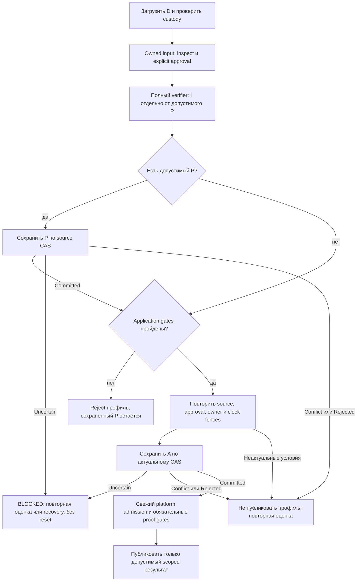

# R05-001 — границы принятия профиля и истории доверия

2026-10-25. **READY_FOR_REVIEW**; научное принятие отдельно от
авторской готовности.

## 1. Вопрос и область доказательства

Как связать portable verification → durable acceptance → platform admission,
сохранив нужную историю при ошибке, отмене, crash и ротации полномочий?

Метод: чтение адресных исходников и первоисточников, два условных контрпримера
и модель переходов. Криптографический verifier, приложения и ОС не запускались.
Это не security scan, не подтверждённая эксплуатация уязвимости и не VPN PASS.
Точные входы: [SOURCES](SOURCES.md), локальные копии и SHA256 в
`../../../../.artifacts/research/theory-05/R05-001/local-inputs.json`.

## 2. Baseline: что уже известно и не выдаётся за новизну

| Уже покрыто | Основание | Граница текущей реализации |
|---|---|---|
| Exact bytes, partial progress и результат приложения различаются | THEORY §16.3 OP-03; ADR-001; Android request T01…11 | Windows `PrepareArtifacts` возвращает `Progress` отдельно от error; Android production driver отсутствует |
| Подтверждение root/policy извне, backup/clock uncertainty | THEORY §16.6 OP-06, §12.5 | Хеш/AEAD/UUID не дают внешнюю authority, глобальную свежесть или аппаратный antirollback |
| Ready требует совместимых актуальных свидетельств | THEORY §17.1 AD-01, §17.6 AD-06, §12.1–3 | Сохранённый профиль не предоставляет OS permission, TUN ownership или egress proof |
| Source/CAS/clock/cancellation fences | Android `ProfileCheckpointGuard`, `ProfileImportCoordinator`, `ProfileClock`; Windows import/delivery fences | Это непроверенный source, не принятый переносимый SDK или гарантия OS durability |
| Неизвестный исход записи не означает «ничего не произошло» | Android ADR-006 и `EncryptedProfileStore`; Windows `filetxn` | Stage/rename/fsync, recovery и защита от восстановления старого blob требуют платформенной приёмки |

**Добавление этого среза:** две неоднозначности самой семантики прогресса.
Нельзя автоматически переносить внутренние мутации verifier в durable authority;
нельзя описывать все rollback floors одним неубывающим числом без домена и
разрешённой ротации. Это уточнения прежних контрактов, а не новое ядро доверия.

## 3. R05-001-A — промежуточная мутация не всегда разрешает persistence

### Утверждение и основание

Нужно различать: полученные bytes; внутренний intermediate verifier;
**принятые правилами workflow метаданные**; принятый профиль; runtime admission.
Слово «verified» без указания пройденного этапа недостаточно для сохранения floor.

TUF 1.0.36 §5.4.4–5 и §5.5.4–7 ставит проверки final version/expiry перед
принятием и сохранением нового timestamp/snapshot. Новый просроченный объект
отбрасывается. Intermediate root — отдельный случай последовательной цепочки
§5.3: его сохранение предшествует проверке срока конечного root. Эти правила
сверены также с опубликованной 1.0.37. [P1], [P2]

В pinned go-tuf2.4.2 `UpdateTimestamp` присваивает внутренний указатель до
`checkFinalTimestamp`; `UpdateSnapshot` аналогично меняет набор до final check.
Но `Updater.loadTimestamp/loadSnapshot` сохраняют оригинальные bytes после
успешного возврата. Мутация плюс error **не является самостоятельным свидетельством
права на durable floor**. [P3], [P4]

Current Windows `retainedState` берёт timestamp/snapshot из workspace cache,
а не из этих указателей; root обрабатывается отдельно. Поэтому отсутствие
просроченного входящего timestamp в возвращённом cache само по себе не дефект.
Вызов `GetTrustedMetadataSet` не превращает его в разрешённую историю.

### Контрпример и предел вывода

Пусть сохранён timestamp v10. Из сети получен корректно подписанный timestamp
v1000, уже истёкший к началу workflow. Lower layer устанавливает intermediate,
затем возвращает expiry error. Adapter, журналирующий все такие мутации, запишет
floor1000; следующий обычный v11 будет отклонён до разрешённого восстановления.
По нормативной ветке новый v1000 не становится принятым timestamp.

Это **собственный условный вывод о доступности**. Нужен реально допустимый signer:
например, quorum онлайн-роли был скомпрометирован либо существовал ранее
подписанный проблемный объект. Подделать подпись этот сценарий не позволяет.
Компрометация онлайн-роли уже даёт другие способы fast-forward; здесь не заявлена
новая универсальная атака или её воспроизведение на продукте.

Контраргумент: локально загруженный **ранее принятый** timestamp может теперь
быть просрочен. Его прежнюю историю нельзя стирать только из-за expiry.
Также valid timestamp, принятый до отказа следующего target/application шага,
остаётся допустимым progress. Контекст происхождения различает эти случаи.

### Предлагаемое решение

Уточнить OP-03 и Android T07/KDoc: «сохранить допустимый предшествующий progress
при final error» не означает «сохранить именно объект, вызвавший error».
Не исправлять Windows слепым копированием всех SDK pointers в cache.

Переносимый output должен связывать exact owned bytes с ролью, исходным
checkpoint, verified root lineage, выполненным workflow шагом и причиной
допустимости сохранения. Достаточны узкие закрытые состояния существующего
adapter; названия новых production DTO данным отчётом не вводятся.

**Цена/риск:** дополнительная классификация, bounded хранение original bytes и
review каждого перехода; ошибка классификации способна как потерять нужный floor,
так и надолго заблокировать обновление. Нельзя доверять одному типу исключения,
одному fetch/store callback или повторно сериализованному объекту.

**Reuse:** сохранить upstream crypto/full workflow. Современный python-tuf7.0.1
тоже отделяет неуспешный intermediate от последующей записи; это независимый
кодовый ориентир для чтения, не основание добавить Python в приложение. [P6]

## 4. R05-001-B — монотонность зависит от полномочий и разрешённых переходов

### Утверждение и source boundary

Нормативный §5.3.11 предусматривает удаление зависимой trusted timestamp/snapshot
истории при ротации соответствующих ключей. Следовательно, root lineage и
application history продолжаются, а числовой floor подчинённой TUF-роли может
перестать применяться. Это не обычный reset установки или профиля. [P1], [P2]

В захваченном Go path `onlineRefresh → loadRoot → loadTimestamp → loadSnapshot`
нет явного шага такой инвалидации; Windows до Refresh копирует предыдущий Cache
в workspace. Повторная проверка старой подписи иногда сама отвергнет старый cache,
но не покрывает все сочетания ротации ролей. Это адресный source-кандидат для
проверки recovery, а не заявление о полном несоответствии SDK спецификации. [P4]

### Конечный контрпример

1. Под root R7 сохранён действующий timestamp t5, указывающий snapshot version100.
2. Валидная dual-threshold цепочка переводит в R8: ключ snapshot S заменён S′,
   timestamp key T сохранён. Все product threshold/role constraints соблюдены.
3. Publisher после ротации выпускает timestamp t6 с snapshot version1, как
   допускает соответствующая recovery-ветка; новый snapshot подписан S′.
4. Загрузка старого t5 под R8 успешна: его signer T не менялся. Go lower layer
   сравнивает новый snapshot reference1 с сохранённым 100 и отклоняет t6.
5. Сохранение нового root вместе со старым cache повторяет отказ при следующем
   запуске. Одного повторения download или смены транспорта недостаточно.

Вывод следует из порядка вызовов и сравнений, **не исполнялся**. Если текущий
publisher никогда не сбрасывает эти счётчики, этот сценарий сейчас может быть
недостижим в штатной публикации. Но тогда восстановление после fast-forward
остаётся отдельным непокрытым контрактом, а не доказанной возможностью.

### Что адаптировать и чего не сбрасывать

Требуется переход с доказательством разрешённой инвалидации: прежние/новые
полномочия, точная root chain и зависимые role caches, которые больше нельзя
восстанавливать как active floors. Нельзя автоматически брать `max` всех номеров
версий независимо от смены полномочий. Root version/anchor, application epoch/
counter/equivocation history, cumulative bans и credential custody данным
переходом не обнуляются.

Новый root и обязательство инвалидации надо проводить через согласованный
durable checkpoint. Если промежуточный шаг переживает crash, восстановление
должно знать, какой старый cache запрещено снова сделать активным. Номер нового
root сам по себе не описывает, какие полномочия изменились.

В legacy go-tuf0.7.0 есть готовый образец сравнения прежних/новых role key sets
и удаления зависимой metadata после отзыва threshold. Его таблица относится
к более старому draft и **не совпадает автоматически** с выбранным §5.3.11:
использовать как reference идеи, затем проверить актуальную семантику. [P7]
В прочитанном python-tuf7.0.1 обнаружен сходный порядок загрузки старого cache;
переезд на него не считается готовым исправлением этого сценария. [P6]

**Цена/риск:** хранение transition provenance, правила crash recovery и явная
проверка областей reset. Слишком широкая инвалидация создаст rollback;
слишком узкая сохранит fast-forward lockout. Изменение wire/SDK требует решения
его владельца; отчёт ничего не регистрирует и не реализует.

## 5. Предлагаемая state machine

Это модель контракта для рассмотрения, не существующий SDK/ProtectionController.

| Объект | Смысл | Чего не предоставляет |
|---|---|---|
| D | Последний согласованный сохранённый checkpoint: enrollment, root lineage, scoped role cache, application history, bans, custody/floor | Сам по себе не свежий runtime permit |
| I | Owned input и рабочий intermediate verifier | Не позволяет менять D по одному pointer/error |
| P | Допустимый progress по конкретному workflow переходу, включая нужную инвалидацию | Не принятый пользовательский профиль |
| A | Candidate профиля после TUF **и** application gates, основанный на правильном D/P | Не successful disk commit и не разрешение на Connect |
| L | Эфемерный платформенный допуск к точным owner/intent/profile/policy/epoch/deadline | Не переносится через reboot/нового worker и не продлевает подписи |

### Инварианты границ

1. **P разрешён правилами шага.** Старая принятая история, valid predecessor и
   отклонённый новый объект различаются. Не строить floor из непроверенного
   inbound issued-at/version и не объявлять parse/shape/AEAD доверенной подписью.
2. **Один source.** Preview/approval, P, A и store CAS связаны с одним enrollment
   и точными исходными bytes. После сохранения P candidate A должен соответствовать
   обновлённому checkpoint. CAS ловит stale write, но не доказывает криптографию.
3. **Отмена не откат истории.** До допуска profile commit отмена может отвергнуть
   A, сохраняя уже допустимый P. После допуска возможен TOO_LATE/Uncertain;
   underlying owner удерживается до actual return, неизвестность не «успех».
4. **Crash имеет предел.** Чистый verifier без внешних side effects не может
   гарантировать сохранение volatile P при hard kill до его передачи store.
   Обещание восстановления относится к последнему доказанному commit; усиление
   до каждого шага потребует отдельного durable протокола, а не новой надписи.
5. **Admission time и commit completion различаются.** Fsync может закончиться
   после expiry. Сохранение такого состояния не продлевает authority: runtime
   заново проверяет deadline. Нельзя откатывать counters ради автозапуска.
6. **Часы и custody остаются платформенными.** Fixed TUF reference time не
   authenticated UTC. После reboot нельзя переносить старый elapsed deadline.
   Clock/floor/key uncertainty ведут в существующий recovery, без fresh install.
7. **Durable acceptance не Ready.** Android consent/lockdown, native/TUN owner,
   protected-path scope и Windows барьер проверяются отдельно; старые сессии
   не теряют действующие ограничения срока при selector switch.
8. **Scope отказа явный.** BLOCKED относится к операции/неопределённости доверия,
   а не автоматически к пользовательскому Disconnect. Текущий L оценивается по
   собственным сохраняющимся authority/protection фактам. Один отказ доставки
   сам по себе не отменяет ещё действующий профиль; новый отзыв или потеря
   доказательства полномочий не разрешают продолжать старую сессию.

### Платформенное отображение

| Граница | Windows source | Android source / ограничение |
|---|---|---|
| P и exact bytes | `delivery.PrepareArtifacts`, `Progress`, `retainedState`, `retainDeliveryProgress` | `ProfileTrustWork.deliveryProgress`, T05…11; production verifier ещё отсутствует |
| Source fence и сохранение | import journal, `filetxn.BeforeCommit`, metadata binding | `ProfileCheckpointGuard`, `store.write(expected, ...)`, generation/enrollment CAS |
| Неизвестный commit | Journal recovery; rename/flush semantics требуют native evidence | `EncryptedProfileStore` stage/fsync/rename + typed uncertainty; OEM durability не проверена |
| Clock и срок | import deadline, runtime validity/floor | `ProfileClock`, fresh check перед admission; signed bound отдельно от 5s observation TTL |
| Runtime | Manager/engine и барьер, не полномочие verifier | `RuntimeSourceProvider` только контракт, production provider отсутствует; OS/JNI отдельны |

AtomicFile документирует необходимость внешней синхронизации. Его имя не
заменяет CAS/recovery. Microsoft описывает отдельные flush/move гарантии;
их нельзя автоматически приписать любому вызову `os.Rename`. [P8], [P9]
Это предел доказательств текущей state machine, уже известный OS gate,
а не третий новый дефект.

## 6. Будущие конечные проверки — все NOT_RUN

Это спецификация приёмки после отдельного разрешения; исполняемых fixtures,
тестов и новой cryptographic реализации этим срезом не создаётся.

| Case | Вход/граница | Требуемый различимый outcome |
|---|---|---|
| A1 | Новый expired timestamp с большей version; прежний cache принят ранее | Reject нового объекта; не повысить его floor по одной intermediate mutation |
| A2 | Ранее принятый cache теперь expired; publisher недоступен | Сохранить историю; не разрешать устаревший target/Connect |
| A3 | Valid timestamp, затем expired snapshot или неверный target hash | Сохранить только допустимые predecessor steps, без artifact proof |
| A4 | Bad signature/hash/shape и совпадающий номер версии | Никакого нового P из input; same-version equivocation — отдельная application policy |
| A5 | Валидная root chain, конечный root expired | Сохранить разрешённую lineage, запретить финальный target; не смешать с A1 |
| B1 | R7→R8 меняет snapshot key; timestamp key тот же; snapshot reference100→1 | Разрешённая инвалидация зависимой TUF-истории; application history неизменна |
| B2 | Root version вырос, подчинённые ключи не менялись | Не обнулить counters только из-за нового номера root |
| B3 | Root dual-threshold/signature/version chain неверна | Никакой разрешённой инвалидации или нового root authority |
| B4 | Crash после durable root progress, до следующего metadata шага | Не воскресить cache, который transition запретил; сохранить причину recovery |
| C1 | Отмена после valid P, до profile admission | P retained или storage uncertainty; A не применён автоматически |
| C2 | Cancel/kill после mutation, timeout до actual return | Не повторять запись/создавать нового owner как будто эффекта не было |
| C3 | Crash на stage/file sync/rename/directory sync каждой стороны | D старый/новый согласованный либо explicit pending/uncertain; без auto-reset |
| C4 | Срок истёк во время медленной записи A | Не публиковать Ready; сохранённая история не откатывается |
| C5 | Потеря key, старый корректный AEAD blob, clock jump/reboot | Recovery/blocked в объявленной threat scope; не обещать hardware freshness |
| C6 | Старый SDK/result/provider после нового intent/policy/epoch | Не выдать новый L по старому checkpoint/deadline |

## 7. Предложение по очередности разработки

1. **TH-03 / AND-04-S4b T05–T11:** нужно уточнить смысл persistable P,
   примеры A1/A2/A3 и разрешённые rotation resets. Это до реализации общего seam.
2. **Тот же trust owner:** согласует transition/provenance/output contract,
   включая original bytes, bounded ownership, cancellation и partial error.
   Сохранить выбранный Go crypto; не вводить second runtime/canonicalizer.
3. **Windows owner:** адресно проверяет B1 по captured `PrepareArtifacts` path;
   **Android owner:** принимает согласованный contract в существующий whole
   libbox adapter.
4. После разрешения — targeted semantic cases, затем отдельная OS durability/
   process/native/device приёмка. Только после неё можно обсуждать работающую
   recovery/admission систему; сертификат SDK или build этого не доказывает.

Новые backlog IDs не создаются. Модель связывает TH-03/07, FR-008/011 и AND-04/13/14;
исполнение/барьеры — у соответствующих lifecycle владельцев.

## 8. Предлагаемый вывод для общей теории

Место: уточнение §16.3 OP-03; ссылка из §12.5 и §17.6.

> Сохранение progress при final error требует указания пройденного workflow
> шага. Внутренний intermediate go-tuf не является разрешением сохранить новый
> incoming floor. Ранее принятый expired cache и valid predecessor сохраняют
> историю; новый отвергнутый expired timestamp/snapshot не должен автоматически
> становиться durable authority. Intermediate root обрабатывается по отдельным
> правилам цепочки. Нужны original bytes и provenance каждого принятого перехода.
>
> Монотонность истории определяется областью полномочий. Подтверждённая ротация
> может инвалидировать зависимые TUF floors, сохраняя root lineage, application
> epochs/counters, bans и custody. Root progress и обязательство инвалидации
> проходят согласованное сохранение и crash recovery. Ни verified, ни committed
> не означает platform admission/Ready; после ожиданий заново проверяются
> source, owner, policy, clock и действующие сроки. [P1], [P3], [P4]

До принятия этой формулировки не объявлять прежний код ошибочным из-за одного
отсутствующего intermediate и не менять принятую трактовку в других чатах.

[P1]: https://theupdateframework.github.io/specification/v1.0.36/#detailed-client-workflow
[P2]: https://theupdateframework.github.io/specification/v1.0.37/#detailed-client-workflow
[P3]: https://github.com/theupdateframework/go-tuf/blob/f5edbde31e5507f46db2069402dc38903fe6d9d4/metadata/trustedmetadata/trustedmetadata.go#L103
[P4]: https://github.com/theupdateframework/go-tuf/blob/f5edbde31e5507f46db2069402dc38903fe6d9d4/metadata/updater/updater.go#L307
[P6]: https://github.com/theupdateframework/python-tuf/blob/49eb1da48c58cf0cbb0f2e490f7ad39fbd8c1f15/tuf/ngclient/updater.py#L381
[P7]: https://github.com/theupdateframework/go-tuf/blob/6ad7fe593e4042db3544c4b0fedbe66bac371c42/client/client.go#L335
[P8]: https://developer.android.com/reference/android/util/AtomicFile
[P9]: https://learn.microsoft.com/en-us/windows/win32/api/winbase/nf-winbase-movefileexw

---

## 9. R05-002 — минимальный durable cut и prepare/commit/adopt

2026-10-25. **READY_FOR_REVIEW**. Самостоятельный следующий срез DEPTH-CYCLE-002.
R05-001 A/B выше сохранены как предложенные; ACCEPTED им не присваивается.
Самостоятельный оппонирующий проход выполнен; scientific ACCEPTED/независимого
review и продуктовой приёмки этот статус не означает. [Handoff R05-002](handoffs/R05-002.md).

### 9.1. Новизна, предпосылки и значение «минимальный»

R05-001 различил intermediate/P/A/D/L и lawful reset. Здесь добавлены:

1. Нижняя граница **информации**, необходимой для автоматического восстановления:
   cache должен быть связан с основанием своих floors или протокол должен
   исключать неоднозначный durable cut. Одного текущего root недостаточно.
2. Разбор незавершённого commit как множества возможных cuts, а не boolean;
   разные барьеры persistence и adopt, включая потерю ответа после commit.
3. Необходимое API-условие для per-root durability и purpose-specific время.
   «Один min всех сроков» не определяет смысл полномочия и может смешать import,
   running VPN и краткую свежесть подготовки.

**Модель:** сеть может задерживать/повторять/подменять bytes, но не подписывать
за нескомпрометированный quorum. Доверенный root quorum и целостность исполняемого
кода предполагаются. Локальный storage/custody сначала считаются корректными
в пределах объявленной crash модели. Злонамеренный restore старого целого cut
рассматривается отдельно: обычный AEAD/CAS от него не защищает.

«Минимум» ниже сохраняет safety **и заданную способность принять законное
обновление/восстановление**. Для safety без требования доступности нулевой
полезный state с вечным BLOCKED тривиально допустим. Число байтов, оптимальный
формат или универсальная минимальность не доказаны.

Automatic positive branch предполагает, что нужные входы/полномочия доступны
и underlying IO возвращается. Из этой модели не следует bounded recovery time,
wait-free реализация или способность завершить навсегда зависшую native операцию.

Доказательство необходимого различия: пусть `E(h)` — сохраняемое представление
истории h, `F(h,x)` — обязательный ответ на действие x по выбранному контракту.
Если для двух допустимых историй `E(h1)=E(h2)`, но `F(h1,x)≠F(h2,x)`, восстановитель,
получающий только E и x, не выдаст оба правильных ответа. Он должен либо хранить
дополнительное различие, либо исключить одну историю протоколом, либо пожертвовать
автоматическим принятием и перейти к независимому recovery. Это собственный
аргумент различимости, не новый опубликованный алгоритм или оценка entropy.

### 9.2. Какие данные образуют согласованный cut

Обозначим `D=(scope,H,B,M,A,C,F,r)`. Это логические семейства **данных или
эквивалентных гарантий протокола**, не новый wire/DTO и не новый canonicalizer.

| Семейство | Нужное различие | Контрпример при утрате |
|---|---|---|
| scope | Repository/enrollment/purpose и независимое основание первоначального доверия | Чужой self-signed root или восстановленный backup принимается как новая установка |
| H | Текущий доверенный original root и достаточное основание его continuity | «Подписан самим собой» не устанавливает связь с прежней authority |
| B | Контекст принятия role floors и незавершённая обязанность reset; либо atomic protocol, исключающий такой остаток | Новый root + старый cache неотличимы от cache, законно принятого уже после reset |
| M | Original bytes принятых role records, их identity и область применимости | Rejected intermediate или одинаковый номер другой роли поднимает floor; mix-and-match |
| A | Принятый exact profile/application identity, эпоха/counter, cumulative bans/history и pending-policy ограничения | TUF reset неожиданно разрешает старый профиль или удаляет ранее принятый отзыв |
| C | Связь с ожидаемой custody/enrollment, не secret bytes в журнале | Ключ без checkpoint превращается в автоматическое enrollment, старый blob — в новую authority |
| F | Неубывающая доверенная история локального времени и её модель; signed time facts с purpose | Incoming issued-at или старый elapsed timestamp выдаёт свежесть после reboot |
| r | Source/CAS и согласованность commit единицы; может предоставляться store | Поздний результат от D0 перезаписывает более новый D1 либо компоненты разных commits смешиваются |

Digest устанавливает identity exact bytes, не authority или свежесть.
Storage generation, TUF version, application uint64 epoch/counter и elapsed time
имеют разные типы и области. Ни приведение их к одному Long, ни общий `max`
не задают отношение допустимости.

**Граница H:** при доверенном аутентифицированном локальном checkpoint допустимо
доверять сохранённому trusted head без хранения всей цепочки от genesis.
При импорте недоверенного backup это допущение не переносится: нужна доказанная
цепочка от имеющегося anchor или новое независимое approved recovery основание.
Запечатать inbound root новым локальным ключом недостаточно. Если отдельно
требуются все original historical roots для автономного replay, их объём растёт
с числом записей; fixed cap потребует разрешённого checkpoint/compaction или
явного resource blocker. Hash сам по себе исходные bytes не восстанавливает.

**Граница C:** Keystore creation и запись файла не являются общей транзакцией.
Состояние «alias есть, файла нет» совместимо и с первым interrupted enrollment,
и с потерей старого checkpoint. Одно наличие alias не различает эти истории.
Существующий Android store правильно трактует его как incomplete, а не Empty;
это baseline, не новое исправление. Root/manual restore за пределами доверенного
локального storage требует внешнего retained anchor или ослабления обещания.

### 9.3. Почему нужен cache basis/reset frontier

`ResetAllowed` — явный предикат выбранной версии спецификации и application
policy на **проверенную** root transition. Он не вычисляется из входящего флага
«reset=true». §5.3.11 TUF1.0.37 и legacy reference различаются условиями/таблицами;
нельзя молча приравнять любое увеличение root version, удаление threshold ключей
и любое изменение role assignment. [Q1], [Q3]

Root-prefix obligation ещё не является разрешением выполнить финальный reset:
порядок final-root freshness/rotation checks сохраняется. Если root progress
сохранён до final check, состояние должно обозначать эту незавершённость;
нельзя выдать его за завершённый новый домен и принять lower metadata заранее.

Ручной контрпример минимальности B, с доверенным TUF reference time и корректными
подписями, без исполнения:

- **h_pre:** под R7 принят timestamp t5, reference snapshot100; snapshot ещё не
  принят. R8 законно меняет snapshot S→S′, сохраняет timestamp T. После сохранения
  root, до reset, происходит crash. Старый timestamp floor подлежит reset.
- **h_post:** переход на R8 и reset уже завершены. Под R8 снова принят тот же
  exact t5 с signer T; до принятия snapshot происходит отказ доставки. Его floor
  теперь принят в новом домене и должен сохраниться при следующей попытке.
- Проекция обеих историй на `(R8,t5,empty snapshot cache)` одинакова. Storage
  counter без причинной связи не устанавливает, какая история произошла.
- Новый t6 с snapshot reference1 допустим после обязательного reset в h_pre;
  в h_post сравнение с уже принятым 100 запрещает такой rollback без нового
  разрешённого перехода. Сохранять/удалять cache одинаково в обеих историях нельзя,
  если требуется указанная автоматическая recovery способность.

Это не утверждает, что полный текущий platform state действительно теряет B:
production SDK не читался, native трасса не запускалась. Это нижняя граница
контракта и counterexample для формата «только latest root + cache».

При bounded continuation нужен не только root начала **последнего** вызова:
`R7 → R8(expired/prefix) → crash → R9(fresh)`. Если смена S→S′ была в первом
переходе, сравнение только R8/R9 её не обнаружит. Основание cache/reset должно
пережить эту границу. Для цепочки S→S′→S нельзя без review заменить установленный
predicate сравнением конечных точек: смысл path-sensitive rotation должен быть
выбран явно, а не угадан из разных reference implementations.

Допустимые варианты представления:

| Вариант | Когда достаточен | Цена/ограничение |
|---|---|---|
| Atomic coherent root/cache image | Протокол не публикует root с необозначенным старым active cache; root-prefix/final-check фазы тоже определены | Отдельный reset flag может не понадобиться; нужен store atomicity contract |
| Authenticated cache basis + pending transition | Root prefix сохраняется раньше завершения reset/application | Хранить или восстанавливать прежний authority context и причину обязательства; inbound label не proof |
| Ordered durable transition log + checkpoint | Каждый commit replayable, checkpoint сохраняет необходимые floors/obligations | Compaction, torn tail, bounded size и версия формата становятся отдельными gates |
| Ограниченный publisher recovery recipe | После reset старые cached records не проходят новый quorum; неподдерживаемые переходы не обязаны приниматься автоматически | Можно использовать signed key identity как часть контекста, но это уже более узкий контракт, чем все lawful переходы |
| Independent approved recovery | Автоматическую классификацию старого остатка обеспечить нельзя | Безопасно, но требует оператора/резерва; это потеря автономности, а не эквивалентный UX |

B обязан различать нужные случаи, но **не обязан быть отдельным полем**:
atomic protocol может сделать h_pre недостижимой. Нельзя объявить одновременно
минимальными все перечисленные способы хранения.

**Сильное counterevidence:** в exact python-tuf7.0.1 reference test source
`test_new_timestamp_fast_forward_recovery` меняет timestamp keys;
`test_new_snapshot_fast_forward_recovery` меняет **оба** snapshot и timestamp
keys; targets recovery меняет snapshot keys. Это подтверждает существование
готового более ограниченного publisher recipe, а не его выполнение у нас. [Q7]

Для такого пути необходимо проверить, что прежние cached records действительно
не содержат достаточных подписей нового quorum, старый quorum отозван и ключевой
материал не переиспользуется между reset domains. Одно добавление keyID либо
dual-signed старый record может не дать нужного разделения. Если эти условия
и publisher recipe являются частью контракта, конкретные h_pre/h_post для S-only
reset могут стать недостижимыми — это уменьшает необходимое дополнительное
состояние. Но такой subset нельзя объявить поддержкой всех вариантов §5.3.11.
Ротации/резерв ключей/custodian availability тогда становятся ценой решения.

Таким образом, R05-001-B не доказывает дефект типового paired-key recovery:
его конкретная S-only ветка условна. Руководителю надо выбрать требуемый набор
переходов, прежде чем требовать новые поля SDK или признать поддержку достаточной.

### 9.4. Prepare/commit/adopt: таблица переходов

`D0 ≼ D1` означает допустимую подтверждённую историю переходов, а не покомпонентный
max. Invalidated TUF floors могут уменьшиться в новом разрешённом домене;
application history/bans/clock floor данным reset не обнуляются.

Инварианты выбранного контракта:

- **I1 lineage:** H меняется по проверенной последовательности от текущего scope;
  initial/recovery approval не выводится из самого inbound bundle.
- **I2 reset:** каждый reset имеет проверенное основание, точную область и фазу;
  root-only bump не очищает floors, старое obligation не исполняется дважды.
- **I3 classification:** rejected incoming/intermediate не становится P только
  из-за mutation; ранее принятый expired cache сохраняет свою историческую роль.
- **I4 isolation:** TUF reset не сбрасывает A/C/F и cumulative bans; application
  recovery следует своему отдельному разрешению, не metadata version.
- **I5 coherence:** store выбирает один согласованный cut, CAS и exact source
  не могут быть заменены token от другого prepare или новой revision.
- **I6 retention:** подтверждённый P не отменяется generic rollback следующего A;
  невозможность сохранить обязанность блокирует дальнейшее новое принятие.
- **I7 time:** каждый deadline имеет purpose; новый boot не продлевает старые
  подписанные bounds или сохранённый ephemeral clock observation.
- **I8 adoption:** durable D не публикует L без актуального platform owner/intent/
  protection gates; неизвестный writer остаётся ресурсом до actual return.

| Этап / результат | Durable эффект | Следующее допустимое действие | Crash/ошибка |
|---|---|---|---|
| Load/recover | Выбрать один согласованный D, не смесь файлов | Revalidate по объявленной local trust/custody модели | Stage/missing key/corruption ≠ Empty |
| Prepare input/review | Нет нового D | Owned bytes, scope, mode, independent approval/source fence | Preview не capability на сохранение |
| Verify rejected/intermediate | Сам по себе не commit | Отбросить offending record; сохранить только допустимый predecessor P | Pointer mutation/error не свидетельство persistence |
| Verify root step | Допустимая lineage progress ещё не равна durable | Передать original bytes и нужный transition context store | Hard crash до передачи сохраняет только старый D |
| Commit progress admitted | Mutation могла начаться | Один writer удерживает owner и исходный expected source | Timeout не освобождает owner |
| Commit P = Committed | D0→D1, связаны H/B/M и нужные retained ограничения | A заново связано с D1, fresh gates перед profile commit | Отмена A не отменяет D1 |
| Commit P = Conflict/Rejected до mutation | Нового commit нет по контракту store | Reinspect/reverify относительно current D; не merge proofs | При неясном эффекте классифицировать Uncertain |
| Commit P = Uncertain | Возможны разные cuts; D1 не подтверждён и не опровергнут | Recovery/ограниченный gate из §9.5 | Не переименовывать ошибку в отменённую запись |
| Prepare A under D1 | Нового D нет | Application signature/epoch/counter/pins/credentials, exact preview и purpose clock | Валидный P не означает валидный A |
| Commit A = Committed | D1→D2; выбранная identity сохранена | Только fresh adopt с актуальным intent/owner/policy | Возврат UI/callback может отсутствовать |
| Commit A failed/rollback | По корректной transaction семантике остаётся её start cut | Если P уже D1, rollback восстанавливает D1, не D0 | При неизвестной durability — Uncertain |
| Adopt = stale/expired/cancelled | D2 не откатывается | Не запускать/не публиковать новое L, обычная retirement policy | Пользовательское Disconnect — отдельное событие |
| Adopt = admitted | Эфемерный L связан с точным D2 и runtime scope | Защита/owner/required proof gates платформы | Reboot/worker replacement требуют нового admission |

**Два логических решения, не обещание двух fsync:** P retention и A adoption
имеют разные условия. Можно выбрать batching/store design, но общий rollback
P+A в D0 после application failure теряет обязательную историю. Альтернатива —
подтвердить P отдельно либо сохранить обязанность его довести и блокировать
новое принятие. Нельзя считать generic DB rollback разрешённым rollback trust.

**Условная достаточность модели:** от независимо установленного D0, при правильном
verifier/ResetAllowed, authentic неоткатываемом store в выбранной crash модели и
полном Gate, каждый P сохраняет I1…I7, каждый A дополнительно проходит application
gates, а adopt добавляет I8. Atomic recovery выбирает такой cut либо не разрешает
новое действие. Индукцией по этим переходам запрещённый reset/adopt не возникает.
Это proof sketch контракта с явными предпосылками; оно не доказывает, что текущий
verifier/store/OS реализуют их, и не покрывает злонамеренное восстановление старого
целого authentic cut без внешнего anchor.

### 9.5. Неизвестный исход — множество состояний, не вероятность

Пусть `K` — все cuts/owner/clock факты, совместимые с наблюдениями и объявленной
моделью отказа. Для конкретного действия a безопасный критерий:

`Safe(a,K) ⇔ ∀w∈K : Gate(w,a)`.

При конечных согласованных cuts это эквивалентно пересечению разрешений,
`Permit(K)=∩ Permit(w)`, **не объединению и не голосованию confidence**.
Необходимость: если один допустимый мир запрещает a, выбор a нарушает safety
в этом мире. Достаточность условна: K и Gate должны действительно покрывать
объявленные отказы; формула не доказывает полноту наблюдателя/OS protection.

Ручной пример: старый cut допускает каналы {a,b}, новый authenticated policy
оставляет {b}; ответ записи потерян. Использование a не обосновано. Использование
b допустимо лишь при одинаковой принятой identity и **всех** остальных gate
в каждом мире; из одного пересечения channel IDs не следует runtime permit.
Простой owner может блокировать всю новую операцию: реализовывать solver этим
пакетом не предлагается. Ранее действующий L рассматривается отдельно.

K не включает «все неизвестные будущие отзывы во всём мире»: такой global-latest
контракт без независимого источника недостижим. Его scope — известная история,
полученные verified policy obligations и объявленная freshness/threat модель.

Чтение тех же bytes после ошибки не доказывает power-loss durability. После
recovery нужен store-specific выбор согласованного cut и новый source receipt;
старый Prepare token не становится новым grant. CAS Conflict требует нового
вычисления от current D, не присвоения проигравшему proof другой revision.

**Потеря ответа после commit реальна как класс API:** pinned bbolt выполняет
`write → writeMeta → close → OnCommit handlers`. Ошибка/паника хвостового handler
может наступить после commit. Нельзя из «Commit не вернул success» вывести
«состояние осталось старым» и автоматически повторить root/enrollment mutation.
Это source trace, не исполненная атака на приложение. [Q4]

### 9.6. Clock и срок — часть типа разрешения

Для действия p и известного интервала текущего UTC `[t−,t+]` срок `[N,E)`
можно обосновать только при `t−≥N` и `t+<E`. Все величины здесь в одной UTC
единице; эксклюзивный E не округляется вверх. Это собственный вывод из включения
интервалов, не утверждение, что приложение получает authenticated UTC interval.

Persisted floor F даёт лишь нижнюю историческую границу. При неограниченном
clock rollback из `F<E` не следует `now<E`: после reboot одинаковые wall/F
совместимы с реальным временем до и после E. Нужна объявленная clock assumption,
новое доверенное наблюдение либо recovery. Нельзя превратить provisional skew
порог ProfileClock в измеренную погрешность UTC. Старый elapsed anchor после
нового boot не является таким наблюдением.

| Purpose | Что ограничивает | Что не следует автоматически |
|---|---|---|
| TUF workflow/import | Fixed update reference, final metadata и application commit/admission policy | Metadata expiry не даёт глобальную latest-known guarantee |
| Runtime полномочие | Применимые profile/grant/pin/leaf bounds по принятой policy | Reconnect и 5s freshness не продлевают эти bounds |
| Preparation freshness | Краткую пригодность exact candidate/context | Не срок всей VPN-сессии |
| Срок ранее принятого data plane | Только явно применимые к нему authority/policy facts | Ошибка/expiry distribution mirror сама не равна user Disconnect |

В ADR-001 уже отделена freshness доставки от принятой VPN-сессии. Android T10
говорит о minimum всех **применимых** signed bounds. Новый вопрос владельцам
контракта: как именно выбирается применимость по purpose до вычисления min?
Это уточняет и недостаточно типизированное слово deadline в модели R05-001,
а не объявляет готовый Android producer неправильным: он не исследовался здесь.

Ручной trace: профиль принят при времени 1000, timestamp expiry1100, profile
expiry2000, сейчас 1200. Новое TUF принятие требует свежего workflow; running VPN
не обязана истекать в1100 **если** её выданный grant явно не связан с этим сроком.
Если прежний grant уже ограничен 1100, клиент не имеет права продлить его до 2000
путём новой интерпретации: требуется новый approved producer contract/proof.
Все числа — условные метки UTC в одной единице, не измеренные SLO.

### 9.7. Граница библиотеки и необходимый durability seam

TUF предписывает persistence очередного root до продолжения цепочки.
Exact go-tuf2.4.2 сохраняет workspace metadata через write/close/rename, без
`File.Sync` в `persistMetadata`; full Updater не выдаёт platform commit receipt.
Для эпизодического private workspace это не само по себе дефект: окончательная
durability принадлежит platform adapter/store. Но workspace callback не доказывает
переживание каждого root шага при power loss. [Q1], [Q2]

Одновременно невозможны три обещания:

1. Verifier чистый, только один окончательный возврат, без внешнего durable effect.
2. Hard crash может произойти до этого возврата и стереть volatile state.
3. Каждый проверенный root уже сохранён вне volatile state до следующего шага.

Доказательство: crash непосредственно после проверки root, до единственной
передачи результата, оставляет тот же durable cut, что и crash до проверки.
Пункт 3 различает эти истории, пункты 1/2 не позволяют оставить различие.
Это не доказывает небезопасность любого pure verifier: оно ограничивает его
обещание per-step durability. [Q5] даёт стандартный фон различия completed и
crash-interrupted операций; наш аргумент о границе API сформулирован отдельно.

Речь об авторизованном update/Apply, которому обещана per-step persistence.
Read-only inspect/preview такого обещания не получает и не должен тайно сохранять
историю или bootstrap authority. Durable user policy может запросить новый
автозапуск после boot, но не восстановить старый L без новых owner/clock gates.

| Готовый подход | Решение / API и pin | Цена и предел |
|---|---|---|
| Existing platform stores | **Reuse first:** Windows four-target journal и Android one encrypted checkpoint/CAS | Согласовать cut/phase; fault/durability приёмка ещё не выполнена |
| Upstream verified step + внешняя persistence barrier | **Conditional adapt** pinned TrustedMetadata, либо accepted full-updater storage hook | Результат/continuation должен позволять commit до следующего root; полную оркестрацию отдельно review, crypto не переписывать |
| Pure whole-call verifier | **Reuse только с честным per-return contract** | Verified volatile progress при hard kill может потеряться; не назвать это строгой per-root persistence |
| bbolt1.5.0 | **Reference/conditional storage candidate**, MIT; commit `e7a8b2dd498494a3766ba24dd94d3509e5588485`; `Tx.Commit`, `writeMeta`, `NoSync=false` | Go1.25.0/toolchain1.25.11 заявлены; mmap/locking, file/dir durability, Android whole-AAR/ABI и budgets не проверены. Returned bytes borrowed до конца transaction, нужен owned copy |
| SQLite transactions | **Reference/conditional platform candidate**, public-domain deliverable; API BEGIN/COMMIT, выбранный VFS/journal/synchronous режим | WAL NORMAL допускает потерю acknowledged transaction при power loss; режим/OS обязательны. Plain DB/WAL не secret vault; хранить plaintext credentials туда нельзя. Binary/driver pin не выбран, migration не предлагается |
| Наивный atomic rename / AEAD / два meta pages | **Reject как самостоятельное доказательство trust durability/freshness** | Механизм носителя не устанавливает authority, reset scope или freshness старого целого blob |

bbolt данные и meta page синхронизируются в разных стадиях; `NoSync` меняет
гарантию. Это полезный конкретный reference границы write/decision/return, а не
сертификат нового store. README mobile recipe не разрешает отдельный Go AAR.
SQLite документы прямо различают journal/WAL и synchronous modes. [Q4], [Q6]

### 9.8. Ручные traces и будущая конечная приёмка

Все traces — reasoning, **NOT_RUN**. Crash points задаются относительно эффекта,
не выдуманными миллисекундами или byte offsets носителя.

| Trace / case | Положительная ветка | Отрицательная / опровергающая ветка |
|---|---|---|
| T1 Basis | R8 + old basis7 → разрешённый reset → new basis8/cache | h_post уже basis8: тот же reset повторно запрещён без нового основания |
| T2 Bounded roots | R8 prefix + сохранённое obligation → restart R9 → обработать прежнее изменение роли | Сравнить только R8/R9, забыть R7 change; проверка должна поймать потерю B |
| T3 Partial failure | Valid predecessor P committed, target/application rejected: остаётся D1 | Expired incoming intermediate сам поднимает floor либо application rollback восстанавливает D0 |
| T4 Unknown commit | Решение восстановлено store, новый receipt/current source, fresh adopt | Timeout → старый writer продолжается → ещё один writer/самовольный reset/повтор Apply |
| T5 Tail failure | Durable write завершён, ответ/OnCommit/UI потерян: D2 сохраняется, L не выдумывается | Любая ошибка хвоста объявлена доказательством отсутствия commit |
| T6 Clock | Fresh admitted time model, proper purpose и исходный boot anchor | Floor без upper time bound либо старый elapsed после reboot разрешает expired grant |
| T7 Custody | Принятый authentic cut + ожидаемый key; законный explicit recovery отдельно | Key-only/old sealed blob объявляется Empty/fresh/current trust |
| T8 Split decisions | D0→durable P(D1)→ошибка A→rollback к D1 | Общая transaction P+A rollback к D0 потеряла обязательный progress, но новые действия разрешены |
| T9 Admission | D2 committed, current intent/owner/profile/policy/proof → новый L | Stale/cancelled adopt откатывает D или повторно использует старый L |
| T10 Deadline scope | Delivery-only expiry препятствует новому import по policy; running grant проверяется отдельно | Клиент сам продлевает уже выданный короткий grant, ссылаясь на новый research |
| T11 Ready recipe | Paired quorum replacement, старый record не валиден под новым quorum, material не переиспользован | S-only reset, добавление ключа, dual-signed старый cache или reintroduced key нарушают предпосылку implicit domain separation |

После отдельного разрешения нужны finite semantic случаи T1…T11, плюс:

- На каждом durable boundary: до mutation, после stage write/sync, root/image
  publication, decision marker, dir sync и до/после ответа. Повторный crash во
  время recovery тоже обязан давать согласованный cut либо явный blocker.
- CAS race P/A от одного source против нового source: никаких re-labelled proof.
  Root-only change без требуемой role rotation не разрешает очистку floors.
- Wrong repo/enrollment/purpose, same-version different bytes, rejected signature,
  отсутствующий reset witness, corrupted/torn journal и exhausted history cap.
- Для Windows: process kill отдельно от OS/power loss, four-target fixed set и
  актуальные native ACL/reparse/flush guarantees. Для Android: CE locked,
  key invalidation/orphan alias, file/dir fsync, OEM restore и actual worker lifetime.

Конечные logical durability cuts для выбранного store: K0 до mutation; K1 stage
создан до file sync; K2 data synced до publication; K3 root-prefix published,
reset ещё pending; K4 новое согласованное image до durable decision; K5 durable
decision до ответа; K6 ответ/сообщение adopt потеряно; K7 один interrupted
recovery step. Для каждого применимого K — отдельные process-crash и OS/power-loss
ветки; ещё один crash на K7. Если representation исключает K3/K4 или не обещает
определённый failure model, фиксировать N/A с причиной, а не synthetic PASS.

Критерий семантики: ни одна восстановленная последовательность не принимает
действие, запрещённое своим согласованным trust cut; обязательные positive
recovery ветки при выполненных предпосылках и возврате IO завершаются без ручного
reset в выбранной модели. Критерий
durability: каждый success, обещанный как durable, остаётся в допустимой истории
после заявленного класса crash; pending operation может иметь эффект и без
ответа. Произвольный dishonest storage или arbitrary wall time этими cases
не превращаются в решённую задачу.

### 9.9. Оппонирующий review и применимость

| Сильнейший контраргумент | Ответ / предел вывода |
|---|---|
| Без B можно просто всегда BLOCKED | Да: нижняя граница относится к заданному automatic acceptance/recovery, не safety в одиночку |
| Atomic protocol исключает h_pre | Да: B может быть гарантией протокола, отдельное поле не обязательно; нужны root-prefix/final-check ветки |
| Publisher следует paired-key recovery recipe и исключает S-only reset | Да: при доказанном invalid old quorum/cache и отсутствии key reuse это иной допустимый минимум; источник test recipe не доказывает эти свойства нашего publisher |
| Текущий product SDK уже хранит всё необходимое | Возможно; он не читался. Здесь контракт/conditional traces, не новый диагноз его дефекта |
| External anchor/аппаратный monotonic state меняет минимум | Да, если реально доступен/проверен; обычному AEAD alias это свойство не приписано |
| Store DB гарантирует transaction — значит adopt тоже безопасен | Нет: потерянный ответ, current intent/clock/policy и внешний native owner не включены в DB transaction |
| По policy runtime действительно зависит от TUF expiry | Тогда короткий bound правилен; типизация purpose не разрешает его продлить |
| Недостаточно известно о rotation через intermediate или threshold changes | Сохранить unresolved predicate для руководителя. Ни старая draft table, ни общий max не подменяют принятое правило |

**Falsification/applicability:** применение cut аргумента к конкретному продукту
снимается, если его проверенный протокол исключает одну из h_pre/h_post либо
уже содержит эквивалентное различие. При обеих обязательных ветках источник
различия должен быть показан; простой всегда-BLOCKED не отвечает этому критерию.
API-аргумент меняется только с появлением durable effect до возврата,
другой crash модели либо ослаблением per-step promise — это изменение предпосылки,
а не измерение скорости. Clock argument требует реально обоснованного upper bound.

**Windows:** уточнение требований TH-03/FR-008/011/TH-07; reuse текущих journal,
source/retire fences. Не добавлять fifth target или новый owner этим исследованием.
**Android:** уточнение AND-04-S4b T05…11 и accepted renderer contract; storage/CAS,
Keystore/elapsed/worker остаются Android-owned, одна whole libbox integration.
**R03:** policy получает только доступные по hard gates действия; score/confidence
не выбирают удобный cut и не сбрасывают trust/clock history.
**R06:** UX различает «сохранено», «исход неизвестен», «профиль принят» и «VPN
допущена». Recovery kit должен содержать нужное независимое основание, а не
кнопку очистки floors.

Цена: дополнительный context/provenance и recovery branches; повторные durable
барьеры/копии/освобождение mmap требуют реальных resource измерений. Нулевой
overhead или преимущество по скорости не заявлены. Усложнение снижает пользу,
если имеющийся atomic store уже исключает неоднозначные состояния: расширять
существующую границу после проверки, а не вводить все варианты одновременно.

Предлагаемое уточнение THEORY §16.3/§16.6: сохранять согласованный trust cut
вместе с областью floors/reset; различать completed commit, неизвестный outcome
и новый platform adopt. Per-root durability требует явного persistence seam;
deadline вычисляется для указанного полномочия. Это ещё не принятая вставка.

[Q1]: https://theupdateframework.github.io/specification/v1.0.37/#update-root
[Q2]: https://github.com/theupdateframework/go-tuf/blob/f5edbde31e5507f46db2069402dc38903fe6d9d4/metadata/updater/updater.go#L590
[Q3]: https://github.com/theupdateframework/go-tuf/blob/6ad7fe593e4042db3544c4b0fedbe66bac371c42/client/client.go#L335
[Q4]: https://github.com/etcd-io/bbolt/blob/e7a8b2dd498494a3766ba24dd94d3509e5588485/tx.go#L170
[Q5]: https://www.cs.rochester.edu/u/scott/papers/2016_Izraelevitz_TR999.pdf
[Q6]: https://sqlite.org/pragma.html#pragma_synchronous
[Q7]: https://github.com/theupdateframework/python-tuf/blob/49eb1da48c58cf0cbb0f2e490f7ad39fbd8c1f15/tests/test_updater_top_level_update.py#L491

## 10. R05-003 — происхождение сборки, offline verification и разрешение обновления

**READY_FOR_REVIEW, не ACCEPTED.** Это desk/source evidence,
не проверка подписи, установки или VPN. Выводы R05-001/002 не отменяются.

### 10.1. Пробел и утверждение

Общие требования release/provenance ещё не задают достаточную политику принятия
конкретной сборки. Подпись удостоверяет утверждение определённого подписанта;
из этого автоматически не следует разрешение обновить приложение сейчас.

Предлагаемый контракт допуска, если provenance обязательна:

`DeliveryAuthority ∧ ExactPayload ∧ ProvenancePolicy ∧ PlatformPolicy ∧ AdoptGate`.

- **DeliveryAuthority:** актуальная разрешённая TUF/update role, target/version,
  floors и purpose-specific time. Сохраняются выводы предыдущих срезов.
- **ExactPayload:** проверяемое свидетельство связано с точными предназначенными
  к применению bytes; источник expected digest независим от заявления bundle.
- **ProvenancePolicy:** trusted verification material, signer identity и
  независимо утверждённые ожидания к происхождению сборки.
- **PlatformPolicy:** подходящий пакет/платформа/канал, полномочия установки,
  native signing/совместимость по выбранной платформенной политике.
- **AdoptGate:** текущий intent и действительно принятый образ/пара компонентов,
  ownership/lifecycle; process launch сам по себе не readiness.

Это логическое AND, не новый product API и не доказательство достаточности
существующей реализации. Provenance остаётся optional, пока требование явно
не принято и совместимость обязательного gate не обеспечена.

### 10.2. Что добавляет SLSA, чего не добавляет подпись

[SLSA v1.2 verification](https://slsa.dev/spec/v1.2/verifying-artifacts) требует
формирования ожиданий из доверенного основания. Для Snowden следует задать
отдельно package/channel, source identity, допустимый commit/ref, builder и
security mode, buildType и значимые inputs/parameters. Не все строки обязаны
иметь одну универсальную allowlist; политику задаёт выбранный pipeline.

[SLSA provenance v1](https://slsa.dev/spec/v1.2/build-provenance) различает
buildDefinition и runDetails. externalParameters считаются недоверенными;
resolvedDependencies не обещают универсальную полноту вне свойств builder.
Допущенный builder не означает отсутствие злонамеренного исходника.
Проверенная attestation о неизвестном predicateType или неприемлемой сборке
должна дать отказ обязательного provenance gate.

Если скомпрометированный release signer одновременно определяет новые
expectations, дополнительный документ с его подписью не создаёт независимого
барьера против этого signer. Для независимости нужны отдельно управляемые
anchor/policy и действительно разделённые полномочия. Для угрозы только
повреждённого mirror уже полезен TUF target hash; новая цепочка может не дать
существенного дополнительного эффекта и увеличить отказоустойчивые зависимости.

### 10.3. Exact готовый verifier: полезные защиты и граница API

Рассмотрен **sigstore-go v1.3.0**, commit
`22d3691c7b8e0c5530fae3c05577690bfef5cd00`, Apache-2.0, Go1.25.8 по pinned go.mod.
Это кандидат/reference, не установленная зависимость.

В pinned [signed_entity.go](https://github.com/sigstore/sigstore-go/blob/22d3691c7b8e0c5530fae3c05577690bfef5cd00/pkg/verify/signed_entity.go)
NewVerifier требует явную временную конфигурацию. Policy требует identity,
если её проверка явно не отключена; artifact verification включена по умолчанию.
Есть явно названные unsafe opt-outs. Поэтому отсутствие этих защит библиотеке
не приписывается. WithArtifact/WithArtifactDigest связывают artifact со statement;
application обязано передать правильный input. Digest, скопированный из
непроверенного bundle без связи с применяемыми bytes, не выполняет эту задачу.

WithoutStatementPredicate пропускает материализацию predicate в результате;
это не готовая SLSA policy. Проверка builder/buildType/source/parameters остаётся
за потребителем. Нельзя выбрать этот режим, а затем считать отсутствующие
данные уже проверенными. В этом срезе не предложено включать unsafe режимы.

### 10.4. Разные свойства transparency и времени

| Свидетельство | Допустимый вывод | Чего оно само не доказывает |
|---|---|---|
| Подпись доверенного signer | Связь signer и подписанных данных при выбранной policy | Допуск текущего release, безопасность кода |
| Подписанное promise/SET | Обязательство/подписанное утверждение журнала по его формату | Уже состоявшееся включение |
| Inclusion proof и доверенный checkpoint | Membership относительно данного дерева | Consistency с прошлым checkpoint, глобально единственное представление |
| Observer timestamp/TSA | Историческое время в модели выбранного доверенного наблюдателя | Текущее UTC и разрешение нового обновления сейчас |
| Несколько key IDs | Требуемое число доверенных ключей по реализации | Независимость операторов, witness quorum |

В pinned [tlog.go](https://github.com/sigstore/sigstore-go/blob/22d3691c7b8e0c5530fae3c05577690bfef5cd00/pkg/verify/tlog.go)
есть верхний cap entries и обнаружение дубликатов. Порог считается по уникальным
log key IDs: разные indices одного ключа не увеличивают число журналов.
Гипотезы «нет cap»/«любые entries удовлетворят quorum» отвергнуты исходником.
Но key IDs не свидетельствуют об организационной независимости.

V1 допускает promise либо proof; V2 требует proof. Поэтому общий transparency
threshold при V1-совместимости нельзя без уточнения policy назвать обязательным
доказательством фактического membership. Сам proof не придаёт неподписанному
integrated time доверенность; реализация явно различает эти ветки.
Новый consistency/witness protocol здесь не изобретается.

[Sigstore bundle](https://docs.sigstore.dev/about/bundle/) позволяет хранить
свидетельства для последующей проверки. Сертификат, истёкший к текущему моменту,
может соответствовать исторически допустимой подписи при доверенном signing
time. Это не продлевает TUF metadata, profile permit или update authority.
Для cold offline verification нужны заранее доверенные verification material
и определённая policy их актуализации: входящий bundle не сам себе root trust.
Sigstore trust material и Snowden delivery TUF имеют разные authority/cache scope.

`WithCurrentTime` использует ambient time.Now(); такой режим не даёт нашему
explicit-time контракту дополнительных гарантий. Не обходить ошибку времени
переводом часов назад или отключением проверки. Offline readiness относится
к конкретной конфигурации и её зависимостям; все wrapper IO/refresh paths и
поведение при недоступном root store в этом срезе полностью не исследованы.

### 10.5. Применимость к текущему проекту и экономный reuse

Windows update facade уже содержит повторные source/intent checks, pair-readiness
и recovery/image gates. В updateapp.go комментарий прямо различает Start и
readiness. Здесь не заявляется обнаружение отсутствующих gates или дефекта SDK:
production SDK не читался. Новое предложение — уточнить, какое именно
свидетельство о сборке эти существующие границы должны потреблять.

Android AND-14 относится к будущей distribution/update packaging. Свидетельство
о входном AAR не заменяет доказательства о конечном APK; встроенный verifier
не обязательно контролирует сторонний путь установки APK. Точная семантика
native signing formats, post-signing преобразований и image acquisition
оставлена открытой: первоисточники этих платформ в данном срезе не разобраны.

Два условных варианта развития:

1. **Issuer-side gate сначала:** pipeline проверяет provenance до разрешённого
   подписания delivery metadata. Переиспользуются текущие client/update gates;
   клиент доверяет issuer policy, самостоятельной второй проверки не появляется.
2. **Client-side gate при отдельной угрозе:** независимо закреплённые expectations
   и verifier защищают от указанного класса компрометации delivery authority.
   Требуются политика обновления anchors, совместимость старых клиентов,
   bounded parsing/resources и offline recovery. Не брать новый стек целиком
   до обоснования этой угрозы и стоимости.

sigstore-go — готовая проверяющая библиотека для оценки Go-интеграции, а не
отдельный Android gomobile AAR. Whole-runtime compatibility, transitive licenses,
размер, latency, RAM и отказоустойчивость не измерены. Source чтение этих свойств
не подтверждает. Никакого кода/зависимостей в продукт не добавлено.

### 10.6. Конечная будущая проверка — все NOT_RUN

| ID | Case / ожидаемая граница |
|---|---|
| U01 | Exact approved final artifact + допустимая identity/policy + все platform gates → positive candidate |
| U02 | Валидная подпись другого artifact → reject binding |
| U03 | Expected digest взят только из того же bundle, applied bytes другие → reject actual-byte binding |
| U04 | Корректные cert/signature, неверный issuer/SAN → reject identity |
| U05 | Правильный signer, недопустимые builder/source/commit/buildType/parameters → reject application policy |
| U06 | Допустимая provenance, TUF target/floor/time/role запрещают release → reject delivery authority |
| U07 | V1 SET-only и policy требует фактическое inclusion → reject/defer, не mislabeled included |
| U08 | Несколько entries одного log key ID → не достигают порога нескольких ключей; разные keys одного оператора не labelled independent |
| U09 | Cert expired now, доверенное историческое время допустимо → historical signature candidate; текущая delivery policy проверяется отдельно |
| U10 | Cold offline отсутствуют доверенные anchors/нужное свидетельство → typed unavailable/reject, без bootstrap trust из bundle |
| U11 | Обязательный новый gate неизвестен старому клиенту → controlled compatibility refusal/accepted migration policy, не silent bypass |
| U12 | Launch successful, но wrong image/pair, stale intent или readiness отсутствует → не adopted/ready |

Это требования к будущим проверкам, не авторизация их исполнения. Не созданы
fixtures; crypto/verifier/build/tests/native/device/live не запускались.

### 10.7. Граница доказательства и handoff

Самостоятельный opposing pass сохранён в artifacts. Strongest counterevidence:
библиотека уже имеет безопасные identity/artifact defaults и entry caps; TUF
hash уже решает mirror corruption; provenance signer может честно удостоверить
вредоносную сборку. Ни одна находка не объявлена vulnerability библиотеки.

Native GitHub API fetch timeout и Git DNS failure не дали raw pinned checkout.
Pin подтверждён публичной release→commit ссылкой; source разобран через web
rendered records. Их hashes — идентичность capture, не хеши authoritative Git blobs.
Прежние null-ref/null-commit записи помечены невалидными, а не подменены успехом.
Четыре local consumers/plan захвачены при закрытии; это не baseline начала
исследования и не основание утверждать отсутствие drift за всё окно.

Открытые вопросы: threat/issuer-vs-client policy и минимальный набор
expectations; связь final artifact/native signing с installed/executing image;
историческое trust/revocation. Эти области не проверены данным source-разбором.

## 11. R05-004 — final artifact → platform identity → executing/adopted image

**READY_FOR_REVIEW**, [полный конечный contract](R05-004.md),
[handoff](handoffs/R05-004.md), [источники V](SOURCES.md#sources-r05-004).

Новизна относительно R05-003: расположение независимого gate перед исполнением
candidate; flat digest против platform signature identity; разные store/direct
authority; установленный пакет против уже выполняющегося поколения. Windows
existing custody/pair guards учтены и missing defects не объявлены. Android
current/history/multiple signers и SDK-dependent rotation различены. Recovery
не очищает прежние floors. 12 будущих cases NOT_RUN. Raw pinned apksig/framework
sources получены; дополнительные CLI/Android.bp и Windows signature-settings
запросы не дали source evidence. Ни product implementation, ни tests/native PASS.

## 12. R05-005 — offline status knowledge, native time и recovery

**READY_FOR_REVIEW**, [конечный contract](R05-005.md),
[handoff](handoffs/R05-005.md), [источники W](SOURCES.md#sources-r05-005).

Baseline global latest limitation не присвоен заново. Добавлены scoped status
knowledge, profile-specific nextUpdate, условие worst-case freshness для clock
interval, CRL hold/scope counterevidence и негерметичная pTime semantics Windows.
Уточнены different success rules WinVerifyTrust/CertVerifyCertificateChainPolicy.
Uptane2.1 — reference с secure-time предпосылкой, не новый продуктовый стек.
10 future cases NOT_RUN. SDK/реальные OS stores не читались.

## 13. R05-006 — ready multiple-repository approval

**READY_FOR_REVIEW**: [срез](R05-006.md), [handoff](handoffs/R05-006.md),
[SOURCES X](SOURCES.md#sources-r05-006). В pinned go-tuf2.4.2 найден готовый
multirepo search; existing guards учтены. Custom policy agreement, mapping trust,
per-repo progress и availability/IO wrapper остаются отдельными требованиями.
Не предлагается whole-stack автоматическое внедрение. 10 cases NOT_RUN.

## 14. R05-007 — independently governed map migration

**READY_FOR_REVIEW**, [contract](R05-007.md),
[паспорт A/B](handoffs/R05-007.md), [SOURCES Y](SOURCES.md#sources-r05-007).
Alias/cache history, current-governance transition и old-client capability
matrix разобраны как conditional model. Новый raw source факт: Hashes.Equal
common-overlap relation нетранзитивна; manual representative-order trace меняет
quorum outcome. All-hash byte verification учтена как counterevidence против
claim об arbitrary-payload bypass. 13 future cases NOT_RUN. SDK не читался.

## 15. R05-008 — native backup/recovery примитивы и граница restore

26 октября 2026. Полный текст: [R05-008](R05-008.md), краткий разбор
[handoffs/R05-008.md](handoffs/R05-008.md), [источники](SOURCES.md#sources-r05-008).

**R05-18 — уточнённая область.** Защита локального ключа, аутентификация
пользователя, полномочие и непрерывность истории различаются. При откате всех
доступных checkpoints нужна пережившая отказ информация, иначе две истории
неразличимы. Это не доказывает обязательность серверного floor, recovery-secret
или биометрии. Уже сохранённые документы допускают recovery-agent/backup-key
для отдельных DPAPI-сценариев и OEM-исключения D2D при allowBackup=false.
Обычный BiometricPrompt не подписывает смысл показанной операции.

Основной разбор — [R05-008](R05-008.md), поздние условия —
[R05-009](handoffs/R05-009.md) и [R05-010](handoffs/R05-010.md),
согласование с кодом — [K5](../../../planning/knowledge-application/sections/TRUST.md#k5).
Раннее обязательное требование единственной recovery-схемы снято; source-срез
не доказывает итоговые backup rules, hardware level, native restore или RTO.
Статусы отдельных научных утверждений не повышены.
